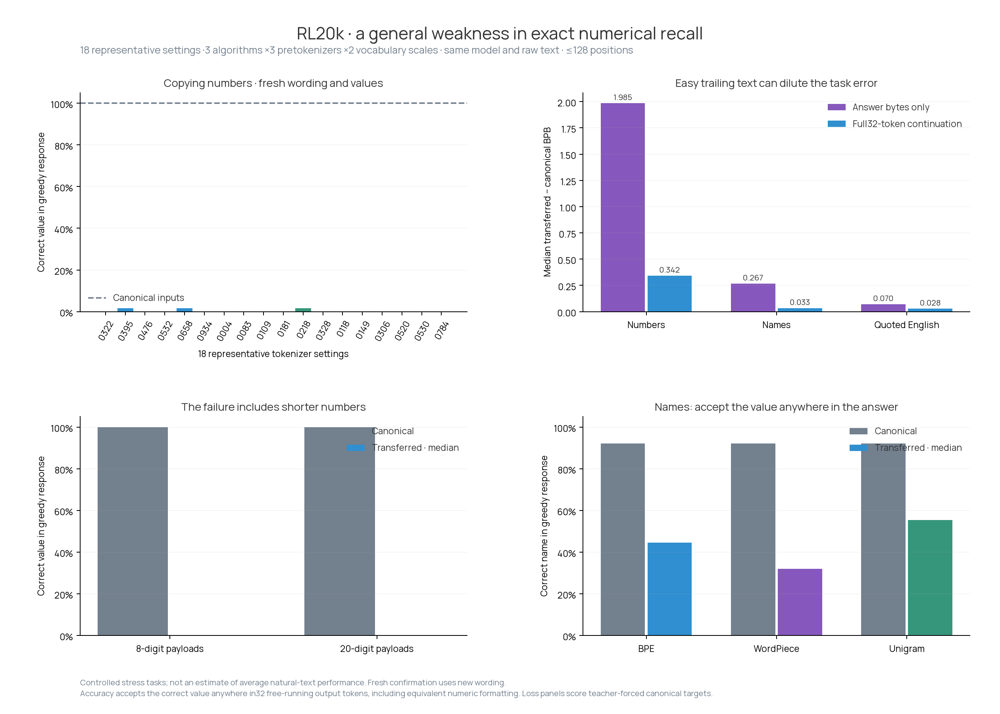

# A repeatable weakness: exact information in transferred prefixes

**Exact numerical copying is a repeatable weakness across all 18 representative tokenizer settings in this probe.** The canonical-input model succeeds on these tasks. The failure repeats with new prompt wording and independently generated examples.

The general setting is read-and-repeat: put a value, name or short sentence in an English record, then ask the same model to reproduce it. Only the input-prefix tokenizer and embeddings change. Keep the complete fact and question, use the fixed canonical output head, and stay within 128 positions.

## A simple eight-digit failure

Exact prefix:

````text
Original entry
Recorded number: 50778117
Repeated entry
Recorded number:
````

Required value: `50778117`. The canonical model writes it correctly.

| Tokenizer algorithm | Representative setting | First line actually generated |
|---|---:|---|
| bpe | 0395 | `5077811` |
| wordpiece | 0118 | `577117` |
| unigram | 0004 | `577117` |

The native tokenizer round-trips the complete prefix. Independent reconstruction matches the stored input features, and zero used prefix tokens exceed the 10-piece surface-form cap in any of the 20 tested settings. The full fact and query fit easily within 128 positions. The [example audit](example-audit.json) records the exact native token boundaries. These checks establish a short, lossless, reproducible failure; they do not yet isolate the learned mechanism that causes it.

## Actual greedy responses: allow extra words and numeric reformatting

This check generates 32 output tokens without feeding the target answer. It accepts the correct complete value anywhere in the response, including extra prose, whitespace, name capitalization and exactly equivalent numeric formatting. It is a post-hoc fairness check on the same frozen task examples, not another independent test set.

| Task | Canonical value accuracy | Transferred median | Transferred range | Large drop on both wordings |
|---|---:|---:|---:|---:|
| Numbers | 100.0% | 0.0% | 0.0%–1.6% | 18/18 |
| Names | 92.2% | 48.4% | 21.9%–76.6% | 15/18 |

Thus the numerical result survives a formatting-tolerant check. Names retain a substantial gap too, but some strict name errors are response-format differences. The [complete generated responses](generation.json.gz) retain original scorer flags and the recomputed punctuation-tolerant flags used here.

## Strict answer-token results on the fresh confirmation wording

| Task | Canonical accuracy | Transferred median | Transferred range | Settings meeting failure criterion on both splits |
|---|---:|---:|---:|---:|
| Numbers | 87.5% | 0.0% | 0.0%–1.6% | 18/18 |
| Identifiers | 46.9% | 14.1% | 3.1%–21.9% | 0/18 |
| Names | 81.2% | 23.4% | 4.7%–57.8% | 18/18 |
| Quoted English | 100.0% | 50.0% | 9.4%–100.0% | 8/18 |
| Fact retrieval | 96.9% | 74.2% | 37.5%–100.0% | 0/18 |

Numbers: canonical accuracy is 100% on discovery and 87.5% on confirmation. The median transferred accuracy is 0% on both. All 18 settings span BPE, WordPiece and Unigram; regex, line256 and no-regex pretokenization; and approximately 64k/120k vocabularies. The separately included earlier weak tokenizers 0003/0635 are not needed for that conclusion.

Names also meet the failure criterion across all 18 settings. Quoted English shows a large confirmed drop in a subset of settings. Identifier and semantic-retrieval prompts do **not** pass our cross-split baseline calibration: canonical identifier accuracy falls to 46.9% on confirmation, and canonical semantic accuracy is 0% on the discovery wording. We do not claim a confirmed general failure from those two tests.



## The loss gap on this setting

For numerical copying, the median confirmation gap across representative settings is **+1.985 BPB on the answer**, and **+0.342 BPB over the full 32-token continuation**. The latter uses the same continuation length as the old evaluation. Easy, shared trailing prose lowers that average while the actual copied value is wrong.

These are task-conditioned stress-test gaps, not revised estimates for the old random-text panel. On the natural-text reference passages, the median 32-token gap is +0.0085 BPB. Small average continuation loss therefore coexists with unreliable exact recall.

## Concrete greedy-generation failures

### bpe · tokenizer 0476

Prefix:

````text
The reported coefficient was 94.078647748163402023e-4.
For the report, the reported coefficient was
````

Required value: `94.078647748163402023e-4`

Actual transferred greedy output: `4.766741634033203e-4. / For the`

The canonical model reproduces the complete target-token sequence on this example.

### wordpiece · tokenizer 0118

Prefix:

````text
The measured value was 33.885982432546108731.
For the report, the measured value was
````

Required value: `33.885982432546108731`

Actual transferred greedy output: `3.89. /  / The measured value was 3.89. /  / The measured`

The canonical model reproduces the complete target-token sequence on this example.

### unigram · tokenizer 0083

Prefix:

````text
The note gives the measured value as 25.596624840460270946.
The clerk checked the date, signed the page, and returned the folder to the shelf.
Question: What was the measured value?
Answer:
````

Required value: `25.596624840460270946`

Actual transferred greedy output: `The clerk checked the value and signed the page. /  / The clerk checked the value and signed the page`

The canonical model reproduces the complete target-token sequence on this example.

## Design and limits

Each split has 64 generated cases per family, equally divided by short/long payload and nearby/separated facts. Confirmation uses a new random seed and different wording templates. Common color/name values can repeat between splits. There were zero encoding/length rejections. The shared panel also includes 153 discovery and 150 confirmation natural English/code/math/medical/legal continuations without image-link markup.

Exact accuracy means every answer token matches the canonical target sequence. This is equivalent to greedy reproduction of that token sequence; it is stricter than accepting alternate tokenizations or paraphrases. Selected failures also include actual free-running greedy outputs. Natural prose accuracy is not interpreted as a task-success rate. Per-token losses agreed with the model’s built-in causal loss.

A large supported failure requires canonical accuracy≥80%, an accuracy drop≥20 percentage points, and a paired answer-BPB 95% interval above zero in both splits. Intervals resample paired cases within the fixed length/distance cells; they do not cover training seeds and are not multiplicity-adjusted. Representative tokenizers are selected by settings/vocabulary size, not by these task losses. This is evidence of a repeatable behavioral weakness across the tested settings. It does not measure its frequency in arbitrary real documents or establish which learned component causes it.

## Files and reproduction

* [metrics.csv](metrics.csv): all settings, tasks, lengths and splits.
* [analysis.json](analysis.json): paired intervals and cross-split support counts.
* [results.json.gz](results.json.gz): frozen plan, shared case metadata, per-token losses/correctness and selected raw examples.
* [PDF plot](behavior_transfer.pdf) and [manifest.json](manifest.json).

Run `python scripts/analyze_behavior_transfer.py --input reports/behavior-transfer-20k/results.json.gz` to reproduce the report. Raw task contexts stay in `blackpantherx86 / anytok-rl-all-pool-20k / behavior-transfer-v1/panel.json`. The plan is `plans/behavior-transfer-v1.md`; generation/scoring source is `scripts/behavior_transfer.py` and `scripts/modal_behavior_transfer.py`.
