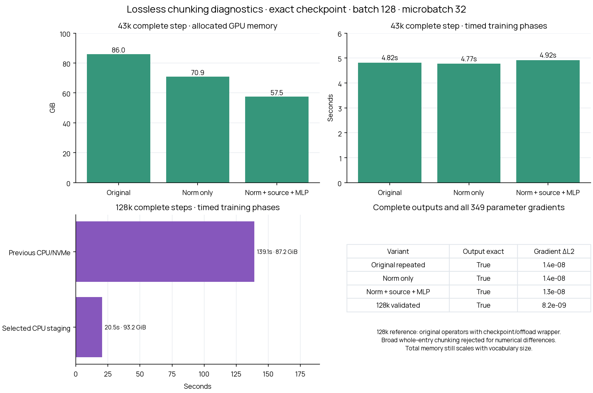

# Fast, lossless memory diagnostics

The broad whole-entry chunking prototype failed the losslessness checks and was rejected. A narrower implementation chunks source-embedding preparation and normalization, preserving the original full matrix operations, global vocabulary attention, native dropout and affine-parameter backward reductions. The running Modal trainer is unchanged.

## Measured results

| Workload | Implementation | Outcome | Peak allocated GPU GiB | Timed training phases |
|---|---|---|---:|---:|
| 43,000 | Original | complete | 86.01 | 4.82s |
| 43,000 | Narrow memory changes, GPU only | complete | 57.47 | 4.92s |
| 128,000 | Previous CPU/NVMe strategy | complete | 87.24 | 139.13s |
| 128,000 | Narrow memory changes, selected CPU staging | complete | 93.24 | 20.51s |



[PDF plot](chunked_memory.pdf) · [Every attempt](results.json)

Timings are one cold measured step per trial, including canonical scoring, complete forward/backward, clipping, optimizer update and any state transfers. They exclude loading, example preparation and numerical comparisons. They are not steady-state throughput claims. Allocated peaks exclude unused allocator reservations; reserved peaks are retained in raw results. An OOM peak is an incomplete measurement.

## What “lossless” means here

The full 43k comparisons use every generated embedding, both BPB losses, lexical loss, final CUDA RNG and all 349 gradient-bearing LM/hypernetwork parameters. Accepted candidates have bit-identical outputs, losses and RNG. Their gradient differences are approximately 1.3–1.4e-8 relative L2, comparable to the unmodified baseline repeated against itself (1.35e-8). Gradients are not claimed bit-identical.

The complete 128k comparison also checks every embedding value, both losses, RNG and all 349 parameter gradients. The validated candidate matches outputs/losses/RNG exactly and gradients at 8.21e-9 relative L2 (maximum absolute difference 2.85e-9, in the token-type embedding accumulator). Its reference uses the original full-shaped operators with the previously verified checkpoint/CPU/NVMe offloading wrapper. This is not an unmodified single-GPU baseline: the unmodified 128k training graph does not fit locally. Native-reference provenance and every phase are retained in native-reference-989-c16384.json. A separate no-grad full-table check against the unmodified original forward is saved as forward-equivalence-128k.json.

## How the narrower implementation works

1. Construct source embeddings in chunks directly in the dtype that the original first matrix operation consumes. All original source scaling and fallback values are preserved. Keep one full native fallback-embedding gradient scatter.
2. Run native FP32 normalization on row chunks, saving the exact original BF16 inputs instead of larger FP32 copies. Reconstruct those FP32 values in backward.
3. Keep the original full-shape normalization weight/bias reduction. Compute the independent input-gradient rows separately, avoiding a full FP32 input-gradient allocation.
4. Combine outer layer and inner operation checkpointing. Matrix multiplications and global vocabulary attention retain their original full shapes. Native dropout is unchanged.
5. The MLP recomputes its original full-shaped operations, preserves the original native parameter-gradient reductions, and reuses its private GELU-gradient buffer after its last use. No matrix reduction is chunked.
6. The validated 128k variant stages inactive Adam tensors (13.82 GiB), completed LM gradients (6.00 GiB) and three immutable normalization inputs (16.11 GiB peak) on CPU. It restores all gradients before clipping and all Adam state before the unchanged fused update. It performs no activation spill to disk.
7. After lexical loss and the LM embedding gradient are computed, the final generated-output buffer is no longer needed. Use PyTorch’s GradientEdge to retain its backward connection while releasing its 1 GiB storage. The diagnostic retains a CPU copy solely for numerical comparison, outside the timed training phases.

**This reduces the coefficient of vocabulary-dependent memory; total peak memory is still not constant in vocabulary size.** Complete layer states and some native full-shape backward operands remain. Fully streaming every operation without changing mixed-precision arithmetic has not been achieved.

## Rejected broad chunking

Whole-entry chunking retained all vocabulary entries and the original global latent attention. Packed full-shape native dropout masks reproduced the original masks and RNG advancement. Nevertheless the real 43k outputs differed by up to 0.02812 and gradients by 0.3897 relative L2. Its 128k step completed at 76.36 GiB and 20.93 seconds, but this result is rejected as lossless. These measurements remain in results.json, and its source snapshot is retained. No thresholds were relaxed to accept it.

## Fidelity and storage

Use the same authorized local copy as the [earlier memory study](../local-memory/README.md): exact step-2,000 trained LM/hypernetwork, populated optimizer, policy, corpus and RNG state, with the original complete 1,000-tokenizer pool and corpora hash-verified. Memory trials force native tokenizer #652 (43k) or #989 (128k), using the original complete batch 128, microbatch 32, variable-length continuations, paired boundaries, maximum 128 LM positions, canonical output head and lexical weight 0.5. These are memory diagnostics on complete native vocabularies, not a tokenizer-quality sweep. Cloud originals remain authoritative.

35 CUDA/unit checks and 13 dashboard checks passed; four expected failures retain the rejected broad prototype. Focused checks cover exact native-width normalization and MLP outputs/input/parameter gradients, full-model equivalence with/without dropout and BF16 autocast, and CPU-staged normalization. The broader rejected prototype has explicit expected-failure tests; its failures are retained rather than accepted with wider tolerances.

## All attempts

| Trial | Outcome | Peak allocated GiB | Seconds (partial for OOM) | Failure phase |
|---|---|---:|---:|---|
| chunked-652-c2048 | complete | 54.10 | 6.66 |  |
| chunked-989-c2048 | complete | 76.36 | 20.93 |  |
| native-reference-989-c16384 | complete | 87.24 | 157.93 |  |
| norm-652-c16384 | out_of_memory | 93.32 | 1.48 | four LM microbatches forward and backward |
| norm-989-c16384 | out_of_memory | 91.04 | 1.17 | hypernetwork forward |
| norm-compact-adam-cache18-652-c16384 | complete | 40.61 | 18.49 |  |
| norm-compact-adam-cache18-989-c16384 | out_of_memory | 88.60 | 13.68 | hypernetwork backward |
| norm-compact-adam-cache6-652-c16384 | complete | 41.92 | 10.73 |  |
| norm-compact-adam-cache6-989-c16384 | out_of_memory | 88.70 | 8.57 | hypernetwork backward |
| norm-compact-adam-direct-652-c16384 | complete | 46.43 | 8.44 |  |
| norm-compact-adam-direct-989-c16384 | out_of_memory | 83.35 | 7.14 | hypernetwork backward |
| norm-deep-652-c16384 | complete | 64.69 | 4.85 |  |
| norm-deep-989-c16384 | out_of_memory | 91.63 | 3.01 | hypernetwork forward |
| norm-mlp-652-c16384 | complete | 57.47 | 4.93 |  |
| norm-mlp-989-c16384 | out_of_memory | 93.12 | 4.60 | hypernetwork backward |
| norm-mlp-idle-652-c16384 | complete | 41.24 | 9.93 |  |
| norm-mlp-idle-989-c16384 | out_of_memory | 88.09 | 8.42 | hypernetwork backward |
| norm-nested-652-c16384 | complete | 70.93 | 4.77 |  |
| norm-nested-989-c16384 | out_of_memory | 91.04 | 1.19 | hypernetwork forward |
| norm-nested-adam-652-c16384 | complete | 57.11 | 8.28 |  |
| norm-nested-adam-989-c16384 | out_of_memory | 93.58 | 5.12 | hypernetwork forward |
| norm-reentrant-652-c16384 | complete | 60.68 | 4.94 |  |
| norm-reentrant-989-c16384 | out_of_memory | 93.12 | 4.60 | hypernetwork backward |
| norm-source-652-c16384 | complete | 61.08 | 4.84 |  |
| norm-source-989-c16384 | out_of_memory | 93.12 | 4.60 | hypernetwork backward |
| norm-source-adam-652-c16384 | complete | 47.27 | 8.31 |  |
| norm-source-adam-989-c16384 | out_of_memory | 83.35 | 7.13 | hypernetwork backward |
| norm-source-v2-652-c16384 | complete | 60.25 | 4.91 |  |
| norm-source-v2-989-c16384 | out_of_memory | 93.12 | 4.59 | hypernetwork backward |
| norm-source-v2-adam-652-c16384 | complete | 46.43 | 8.44 |  |
| norm-source-v2-adam-989-c16384 | out_of_memory | 83.35 | 7.14 | hypernetwork backward |
| norm-source-v2-adam-release-652-c16384 | complete | 46.43 | 8.46 |  |
| norm-source-v2-adam-release-989-c16384 | out_of_memory | 83.35 | 7.18 | hypernetwork backward |
| norm-staged-652-c16384 | complete | 57.09 | 6.15 |  |
| norm-staged-989-c16384 | out_of_memory | 93.15 | 8.01 | hypernetwork backward |
| norm-staged-idle-652-c16384 | complete | 41.25 | 11.10 |  |
| norm-staged-idle-989-c16384 | out_of_memory | 93.78 | 12.70 | hypernetwork backward |
| norm-staged-idle-edge-652-c16384 | complete | 41.25 | 11.12 |  |
| norm-staged-idle-edge-989-c16384 | complete | 93.24 | 20.25 |  |
| norm-staged-idle-nocache-652-c16384 | complete | 41.25 | 11.03 |  |
| norm-staged-idle-nocache-989-c16384 | out_of_memory | 93.78 | 12.73 | hypernetwork backward |
| validated-gpu-652-c16384 | complete | 57.47 | 4.92 |  |
| validated-staged-idle-edge-989-c16384 | complete | 93.24 | 20.51 |  |

## Reproduce

Use `.venv-memory/bin/python` (PyTorch 2.15.0+cu132). The artifact layout and source hashes are retained in the linked original study and individual trial records. Historical candidate-operator implementations are preserved in source_versions/ by SHA-256. The final commands below use the current harness.

```bash
.venv-memory/bin/python -m pytest tests/test_lossless_layer_norm.py tests/test_chunked_hypernetwork.py tests/test_lossless_mlp.py tests/test_local_memory_variants.py -q
.venv-memory/bin/python scripts/run_chunked_memory.py --variant chunked_norm_mlp --label validated-gpu --tokenizers 652 --direct-embedding-backward
.venv-memory/bin/python scripts/run_chunked_memory.py --variant split_norm_disk --label native-reference --tokenizers 989 --offload-optimizer --host-budget-gib 80 --reference-128 modal_results/chunked_memory/reference-128 --write-reference-128
.venv-memory/bin/python scripts/run_chunked_memory.py --variant chunked_norm_staged --label validated-staged-idle-edge --tokenizers 989 --direct-embedding-backward --offload-optimizer --offload-lm-gradients --release-generated-output --reference-128 modal_results/chunked_memory/reference-128
.venv-memory/bin/python scripts/verify_local_memory_forward.py --candidate chunked_norm_mlp
.venv-memory/bin/python scripts/report_chunked_memory.py
```

The controller defaults to complete 43k and 128k trials sequentially; the commands above specify each native vocabulary explicitly. They do not modify or resume production training. Large corpus, tokenizer, checkpoint, gradient and activation files are excluded from Git.
