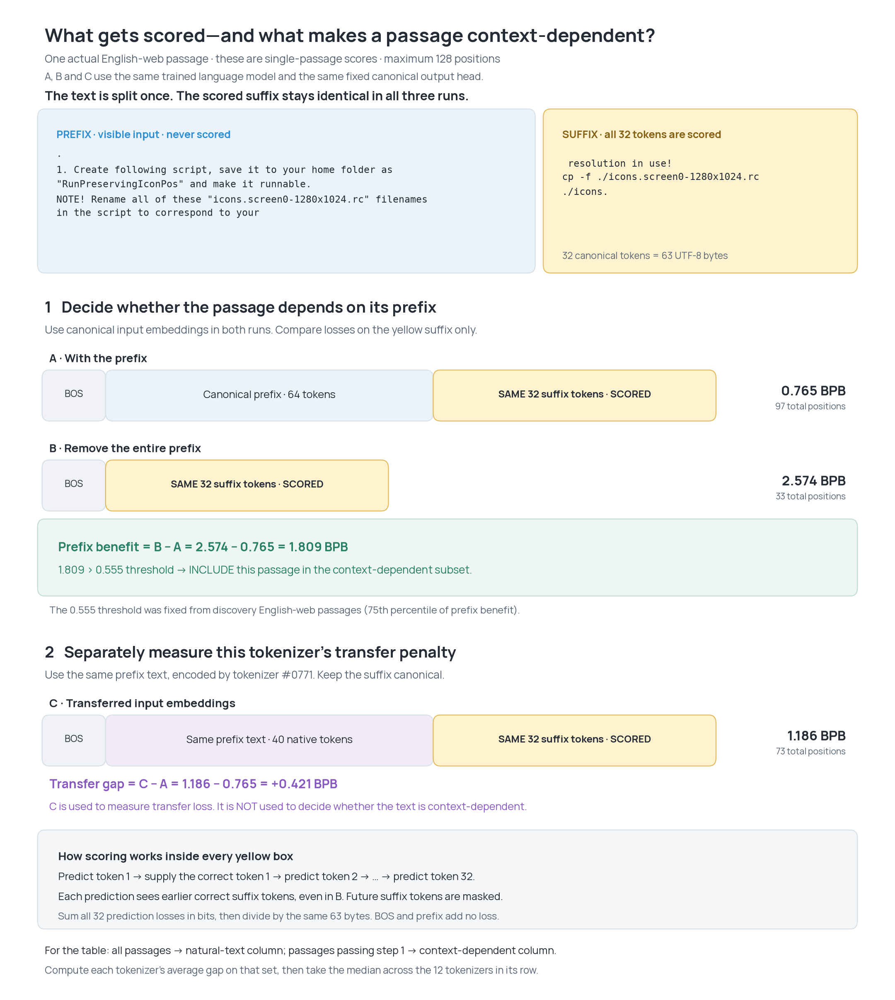

# What gets scored, and how context-dependent passages are selected

[Open PDF](context_eval.pdf) · [SVG](context_eval.svg) · [Exact example and scores](example.json)

The green comparison uses only canonical-input scores, with versus without
the prefix. It determines whether this passage enters the context-dependent
subset. The purple comparison measures tokenizer transfer loss separately.
Only the same 32-token suffix is scored in every run. Earlier correct suffix
tokens are supplied as inputs to later predictions; future tokens are masked.

These numbers describe one actual held-out passage, not dataset averages.
The passage and scores come from the corrected [natural-text evaluation](../natural-transfer-20k/).
Token counts are labeled explicitly; the sequence blocks are not drawn to scale.

Reproduce with `python plotting_scripts/illustrate_context_eval.py` from the
repository root. This reads saved results and requires no model inference.
