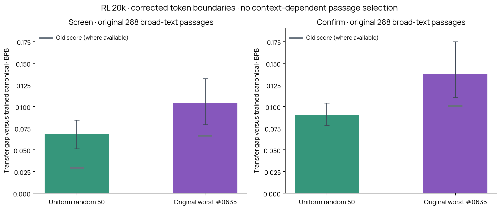

# Corrected broad-text check: random 50 including the original worst

**The old +0.066 BPB result was understated by the cutting protocol.** On the same original screen documents, correcting token boundaries raises tokenizer #0635 to about +0.104 BPB. On the separate confirmation documents its corrected gap is about +0.138 BPB.

This is the final RL20k model, not a new training run. These are the original broad-text samples, not the 229 context-dependent passages used in the recent diagnostic. The exact same frozen random 50 from that experiment are reused. The old worst, #0635, was already in this draw, so there are 50 distinct tokenizers, not 51.

| Text sample | Old random-50 mean | Corrected random-50 mean | Old #0635 | Corrected #0635 |
|---|---:|---:|---:|---:|
| Screen | +0.02936 | +0.06829 | +0.06637 | +0.10398 |
| Confirm | Not measured | +0.09011 | +0.10073 | +0.13782 |

Gap = transferred BPB minus the same trained LM’s canonical BPB on identical targets within each protocol. Lower is better. BPB is byte-weighted within each of nine domains, then equally averaged across domains. The random sample mean includes #0635.

The original worst is also worst among these 50 on both corrected samples. Its gap exceeds the random mean by about +0.036 BPB on screen and +0.048 on confirmation. This does not establish the corrected worst across all 1,000. The random mean remains positive; this is not a case of near-zero loss for the typical sampled tokenizer.

## What is kept fixed and what changes

Both screen and confirmation contain 288 source documents, 32 from each of English web, code, Chinese, Japanese, Arabic, Hindi, math, medical and legal text. No passage was selected because of context benefit, transferred loss or model weakness. All original source IDs and split membership are preserved.

The audit found 128 mismatched seams on screen and 118 on confirmation. All already-valid contexts are preserved exactly, including prefix and all 32 targets. Invalid cuts move to the nearest reversible canonical token end within 64 Unicode characters, using encoding validity only. The old prefix start is retained, with trimming only when needed for the position limit. Because a cut moves, its continuation bytes may change: this is a corrected protocol on matched documents, not an identical-target comparison between protocols.

Each model input is BOS + prefix + 32 canonical continuation tokens, at most 128 positions. The prefix is input only; teacher-forced loss is scored on the continuation. Canonical prefixes are 16–64 tokens; native prefixes are at most 95. Full native vocabularies generate transferred input embeddings. The canonical output head is fixed. Checkpoint, native-tokenizer and surface-feature hashes are verified, and token loss is checked against Hugging Face’s built-in causal loss.

| Sample | Changed cuts | Largest shift (characters) | Scored tokens | Corrected continuation bytes |
|---|---:|---:|---:|---:|
| Screen | 128 | 12 | 9,216 | 27,039 |
| Confirm | 118 | 20 | 9,216 | 26,668 |

## Pretokenizer groups within the random sample

| Group | Count | Corrected screen gap | Corrected confirmation gap |
|---|---:|---:|---:|
| regex | 15 | +0.04954 | +0.06865 |
| line256 | 15 | +0.07435 | +0.09546 |
| no-regex | 20 | +0.07782 | +0.10219 |

These groups contain different sampled tokenizers; this is an association, not a matched pretokenization ablation. The screen and confirmation are different text samples and are not pooled.

Plot intervals and intervals in analysis.json use paired document-cluster resampling within domains, conditional on these fixed 50 tokenizers and one trained checkpoint. They exclude tokenizer-sampling and training-seed uncertainty. No claim of a unique full-pool worst follows from this rerun.

## Data and reproduction

`results.json.gz` contains per-passage summed losses for all 50, old reference scores, source metadata and the frozen plan. Raw text, per-token scores, full tokenizer files and checkpoints remain in persistent Modal Volume `blackpantherx86 / anytok-rl-all-pool-20k`, under `corrected-pool-check-v1/` for the new evaluation and `original-pool-boundary-audit-v1/` for the audit.

Run `python scripts/analyze_corrected_pool_check.py --input reports/corrected-pool-check/results.json.gz --output /tmp/corrected-pool-check` to reproduce. Worker: `scripts/modal_corrected_pool_check.py`; committed design: `plans/corrected-pool-check-v1.json` and `.md`.
