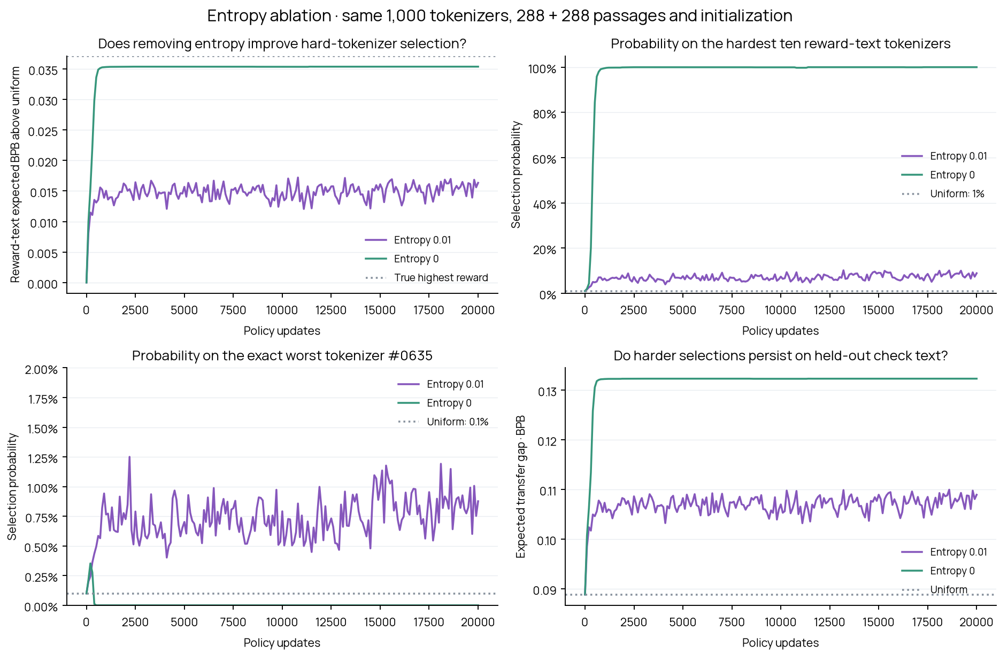

# Frozen-model policy: entropy 0 versus 0.01

**Only the entropy coefficient changes, from 0.01 to 0.** Both policies start fresh from exactly the same uniform initialization and seed 43, and run 20,000 updates. The LM and hypernetwork remain frozen at the same final RL20k checkpoint.

The complete reward table is byte-for-byte identical: all 1,000 native pool tokenizers, all 288 original reward passages and all 288 original held-out check passages, with corrected token boundaries. No passages or tokenizers are dropped, resampled or replaced. This rerun uses exact cached inference losses locally; no new model inference is needed.

The reward remains raw continuation BPB averaged within each of nine domains and then equally across domains. The learner receives only the selected tokenizer’s full-reward-set BPB. Check text and complete rankings are evaluator-only. The shared 18→64→64→1 Tanh network, Adam learning rate 0.001, moving-average baseline decay 0.99, action sampling and update count are unchanged.

| Final measurement | Entropy 0.01 | Entropy 0 |
|---|---:|---:|
| Probability on hardest ten (reward text) | 8.88% | 100.00% |
| Probability on exact worst #0635 | 0.88% | 0.00% |
| Probability on hardest ten (check text) | 5.62% | 100.00% |
| Expected gap on reward text | +0.08323 BPB | +0.10227 BPB |
| Expected gap on held-out check text | +0.10892 BPB | +0.13229 BPB |

The entropy-zero policy’s most probable action is **#0106**, with probability **100.00%**. Its reward-text rank is **2**, and its held-out rank is **8**. It tried 225 distinct tokenizers, compared with 917 with entropy 0.01.

Higher expected BPB means the adversary selects harder tokenizers; the frozen LM itself does not change. The exact worst on both fixed text sets is #0635. The first selection of that ID is recorded separately from concentration on it: merely sampling it once is not evidence of a sustained preference.

With entropy zero, the unconstrained optimum puts all probability on the highest reward. The policy is not told that optimum, the rankings or other tokenizers’ rewards. With entropy 0.01, the optimum trades reward for spread. This is one matched policy seed on a stationary full-screen reward, not a noisy-minibatch or co-adapting-model experiment; it cannot by itself establish why the earlier joint-training run behaved as it did.

## Context and provenance

Both sets contain 32 source documents from each of nine domains: English web, code, Chinese, Japanese, Arabic, Hindi, math, medical and legal. Every input is BOS + native prefix + 32 canonical continuation tokens, at most 128 positions. The prefix supplies context; only the 32 continuation targets are scored. All tokenizers share each passage’s raw prefix, targets and bytes. The output head remains canonical.

All source IDs, corrected cuts, continuation IDs/bytes, native prefix lengths, tokenizer hashes, trained-model manifests and per-passage loss totals are preserved in reward_table.json.gz. The ablation changes the policy coefficient only; run_plan.json identifies the exact original reward-table hash and parent plan. comparison.json verifies that no other policy setting changed.

## Files and reproduction

- `analysis.json`, `curve.json`, `actions.json.gz`: complete final ranks/probabilities and all 20,000 sampled actions.
- `comparison.json`: matched baseline comparison and coefficient-only settings check.
- `policy.pt`: final learned policy; resumable checkpoints every 2,000 updates are saved in cloud storage.
- `reward_table.json.gz`, `run_plan.json`: complete unchanged environment and approved ablation plan.
- `frozen_policy_search.png` and `.pdf`: baseline-versus-ablation plots.

Reproduce locally, without cloud access: `python scripts/frozen_policy_search.py --cache reports/frozen-policy-search-20k/reward_table.json.gz --run-plan plans/frozen-policy-entropy0-v1.json`. The baseline report is `reports/frozen-policy-search-20k/`. Add `--persist` only when cloud checkpoint/report uploads are desired.

The new report and policy checkpoints are persisted separately under aurora / anytok-frozen-policy-search / frozen-policy-entropy0-v1/. Original results and all frozen model, corpus and tokenizer artifacts remain intact in persistent cloud storage.
