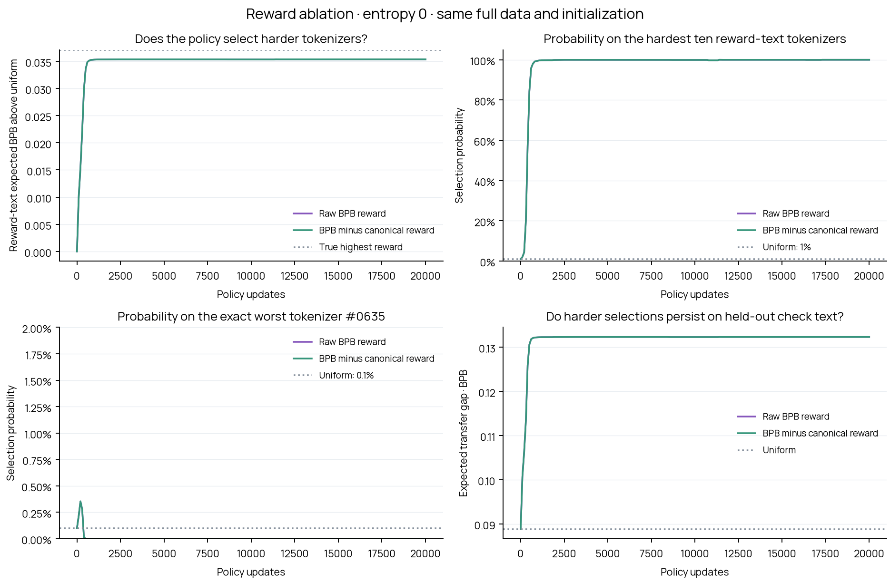

# Frozen RL20k: canonical-gap reward versus raw BPB

**Only the policy reward changes.** The language model and hypernetwork are frozen at the final jointly trained RL20k checkpoint. A fresh shared-settings policy learns for 20,000 updates, starting from the same exactly uniform initialization and seed 43 as its matched raw-BPB run.

`reward = transferred continuation BPB - trained canonical continuation BPB`

The entropy coefficient remains **0**. Adam learning rate 0.001, EMA baseline decay 0.99, network architecture, action sampling and all evaluation data remain unchanged. The matched raw-reward report is `reports/frozen-policy-entropy0-20k`.

## Exactly what is scored

Every one of the 1,000 native training-pool tokenizers is evaluated on all 288 original reward passages and all 288 original held-out check passages. There are 32 source documents per split in each of nine domains: English web, code, Chinese, Japanese, Arabic, Hindi, math, medical and legal. No text or tokenizer is dropped or replaced.

Each input is BOS + prefix + 32 canonical continuation tokens, at most 128 positions in total. Only those 32 continuation tokens are scored. The native-tokenizer and canonical inputs share the same raw prefix, continuation targets and continuation bytes; the output head stays canonical. Corrected token boundaries and full-pool prefix lengths are exactly those of the original complete frozen-policy evaluation.

BPB is byte-weighted within each domain, then averaged equally across the nine domains. Subtracting the aggregated canonical BPB is equivalent to aggregating the paired per-passage loss differences with those same weights. Each split scores 9,216 target tokens; reward continuation bytes total 27,039 and held-out continuation bytes total 26,668.

Exact cached inference losses are reused without modification. Only the sampled tokenizer’s full-reward-set gap enters each policy update. Complete rankings and all held-out losses are evaluator-only. No LM or hypernetwork optimizer or new GPU inference is used.

## Results

| Final measurement | Raw BPB reward | Canonical-gap reward |
|---|---:|---:|
| Hardest ten probability on reward text | 100.0000% | 100.0000% |
| Exact worst #0635 probability | 0.0000% | 0.0000% |
| Hardest ten probability on held-out text | 100.0000% | 100.0000% |
| Expected gap on reward text | +0.102269 BPB | +0.102269 BPB |
| Expected gap on held-out text | +0.132293 BPB | +0.132293 BPB |

The final most probable tokenizer is **#0106**, at **100.0000%** probability (reward-text rank 2; held-out rank 8). The regret run sampled 225 distinct tokenizers.

Of 20,000 sampled actions, **20,000 match** the raw-reward run. The maximum final selection-probability difference is 2.87e-18. These measurements are computed from actual reruns, not inferred from the reward formula.

All 20,000 sampled choices match the raw-reward run exactly. Expected BPB is unchanged on both reward and held-out text.

## Why a different reward can produce the same learning

Canonical BPB on the full fixed reward set is the same **0.966922448642** for every action and every update. Subtracting it shifts every reward by the same constant. Rankings, reward differences and the entropy-regularized optimum are unchanged.

The policy already subtracts an EMA reward baseline. The first update has zero advantage; afterward the EMA shifts by the same canonical constant, so reward minus EMA is also unchanged in exact arithmetic. Floating-point rounding can introduce tiny differences; this report measures any resulting trajectory differences rather than assuming bitwise identity.

For the actual sampled action sequence, reconstructing the raw-reward EMA gives a maximum advantage difference of **7.94e-15 BPB**, and a maximum canonical-offset-adjusted EMA difference of **7.94e-15 BPB**. The exact entropy-regularized optimum is unchanged.

This is one seed in a stationary, exact-full-reward-set experiment. It does not test whether a paired canonical baseline reduces noise when fresh text batches or model weights change during joint training. Higher BPB here means the adversary selects harder tokenizers, not that the frozen model changed.

## Files and reproduction

- `reward_table.json.gz`: complete unchanged loss table, source IDs, continuation IDs/bytes, settings, hashes and model provenance.
- `run_plan.json`: approved reward change, frozen source hashes and separate output paths.
- `reward_trace.json.gz`: every sampled action’s raw BPB, canonical BPB, actual reward, advantage and EMA baseline.
- `analysis.json`, `curve.json`, `actions.json.gz`: complete rankings, progression and all sampled IDs.
- `comparison.json`: actual reward checks and trajectory/weight/probability comparison against raw reward.
- `policy.pt`: final policy; resumable policy checkpoints are persisted every 2,000 steps.
- `frozen_policy_search.png` and `.pdf`: four matched comparison plots.

Reproduce offline: `python scripts/frozen_policy_search.py --cache reports/frozen-policy-search-20k/reward_table.json.gz --run-plan plans/frozen-policy-regret-entropy0-v1.json`. Add `--persist` to upload policy checkpoints and the report to the existing cloud volume.

Persistent storage: Modal profile `aurora`, volume `anytok-frozen-policy-search`, prefix `frozen-policy-regret-entropy0-v1/`. Model, tokenizer and corpus artifacts remain in their existing persistent cloud locations.
