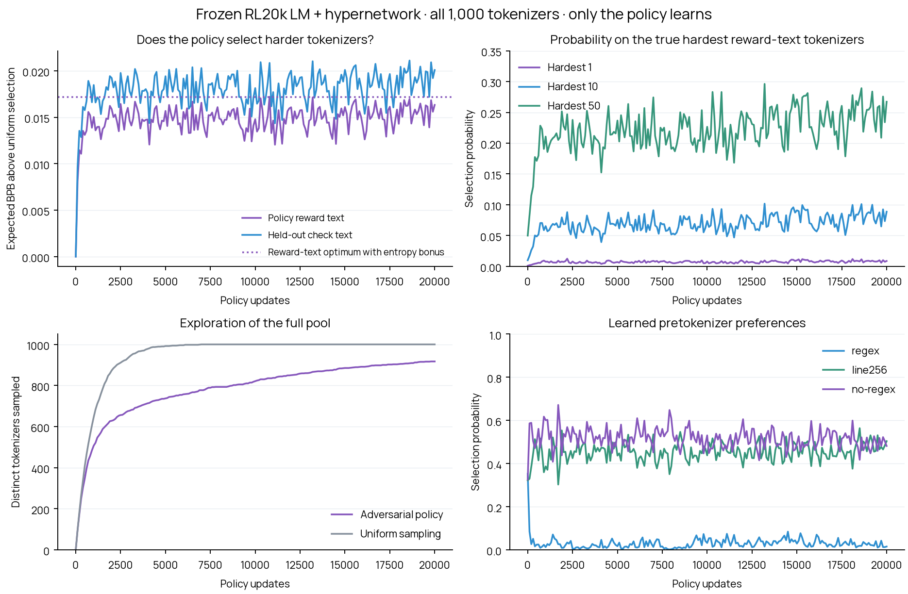

# Can the adversarial policy find hard tokenizers with the model frozen?

We freeze the final RL20k language model and hypernetwork. We train only the original shared-settings tokenizer policy, starting uniformly over all 1,000 existing native tokenizers. Higher BPB is better for this adversary: it wants to find tokenizers that make the frozen model lose more.

## The evaluation is complete

Every one of the 1,000 tokenizers is scored on all 288 original screen passages and all 288 original confirmation passages. No tokenizer or passage is dropped. These are the original broad nine-domain samples, not the 229 context-dependent stress passages and not a subset of already-valid cuts.

The policy receives rewards from the screen text only; we call it **reward text** below. Confirmation text is **held-out check text**: it never enters a policy update, checkpoint choice or hyperparameter choice. Both sets contain 32 documents in each of English web, code, Chinese, Japanese, Arabic, Hindi, math, medical and legal text.

The old seam bug is repaired by the nearest reversible canonical-boundary rule. Already-valid original contexts stay unchanged. Invalid cuts move by at most 64 characters, based only on encoding validity. All 1,000 tokenizers share the same raw prefix and canonical continuation within each passage. Prefixes are jointly trimmed only when necessary to fit all tokenizers. A moved cut can change its continuation bytes; this is explicitly a corrected evaluation protocol.

| Text | Passages | Changed cuts | Additional joint prefix trims | Scored target tokens | Continuation bytes |
|---|---:|---:|---:|---:|---:|
| Reward | 288 | 128 | 4 | 9,216 | 27,039 |
| Held-out check | 288 | 118 | 5 | 9,216 | 26,668 |

## What one policy update does

1. The shared settings network assigns a logit to each tokenizer from its 18 generator-setting features, then samples one ID from the softmax.
2. The learner receives only that tokenizer’s BPB on the full 288-passage reward set. BPB is byte-weighted within each domain, then the nine domains are weighted equally.
3. REINFORCE updates only the policy network. The complete ranking and check-text losses are evaluator-only.

The fixed model’s per-passage losses are computed once and cached. Reusing them preserves the exact reward; no surrogate reward model or score approximation is used. This experiment deliberately supplies the full-screen mean rather than noisy fresh minibatch rewards. It tests whether the policy can learn a stationary hard-tokenizer ranking. It does not reproduce the reward noise or changing model of the earlier joint RL run.

The policy is unchanged: 18→64→64→1 Tanh MLP, seed 43, Adam learning rate 0.001, EMA baseline decay 0.99, entropy bonus 0.01, and exactly uniform initial probabilities. There are 20,000 policy updates. No model or hypernetwork optimizer is instantiated. Scoring is inference-only with gradients disabled, native vocabularies complete, and checkpoint/tokenizer/feature hashes verified.

## Results

| Text | Canonical BPB | Uniform expected BPB | Learned-policy expected BPB | True highest BPB | True worst ID |
|---|---:|---:|---:|---:|---:|
| Reward | 0.96692 | 1.03382 | 1.05015 | 1.07088 | 0635 |
| Held-out check | 0.96534 | 1.05417 | 1.07426 | 1.10318 | 0635 |

The policy learned to choose harder tokenizers on both text sets. On the held-out check text, its expected transfer gap is **+0.10892 BPB**, versus **+0.08883** under uniform selection. The increase of **+0.02009 BPB** persists on text that never supplied a policy reward.

Expected BPB averages over the policy’s selection probabilities; it is not the single hardest sampled observation. Higher means harder selections for this frozen model. Uniform is an exact average of all 1,000 measured tokenizers.

| Text ranking | Probability on hardest 1 | Hardest 10 | Hardest 50 |
|---|---:|---:|---:|
| Reward | 0.9% | 8.9% | 26.7% |
| Held-out check | 0.9% | 5.6% | 25.7% |

The most probable final tokenizer is **#0213**, bpe/line256, vocabulary 120,000, with probability **1.7%**. Its reward-text rank is 10 and held-out rank is 23. The policy sampled 917 distinct tokenizers.

Tokenizer #0635 remains the highest measured BPB across the complete pool on both text sets. The policy first sampled it at update 503; the single uniform baseline first sampled it at update 869. One seed does not establish a general discovery-speed advantage. The final policy favors a hard group rather than making the exact worst tokenizer its most probable action.

The entropy bonus favors retaining some probability on alternatives. We therefore also compare with the exact optimum of expected reward plus 0.01 × entropy: softmax(true reward / 0.01). That reference is used only for evaluation and never supplied to the learner. A policy need not put 100% on one tokenizer to optimize this objective.

This is one policy seed and one frozen model checkpoint on two fixed text samples. Complete rankings establish the highest BPB on these samples, not a universal worst tokenizer for arbitrary text. The test isolates search under stationary exact rewards; success does not establish that the original policy learned equally well with noisy minibatches and a co-adapting model.

## Files and reproduction

- `reward_table.json.gz`: complete per-passage NLL totals for all 1,000 × 576, canonical totals, source IDs, corrected cuts, native prefix counts, tokenizer hashes/settings and the frozen plan.
- `analysis.json`, `rankings.csv`: full reward/check rankings, learned probabilities, counts and reference scores.
- `curve.json`, `actions.json.gz`: training progression and every sampled tokenizer ID.
- `policy.pt`: final policy weights, settings, feature table and selection counts; it contains no LM/hypernetwork weights.
- `frozen_policy_search.png` and `.pdf`: reusable result plots.

Reproduce the policy run with `python scripts/frozen_policy_search.py --cache reports/frozen-policy-search-20k/reward_table.json.gz`, then `python scripts/export_frozen_policy_search.py`. The policy source hash is frozen in `plans/frozen-policy-search-v1.json`. Original worker: `scripts/modal_frozen_policy_cache.py`; local learner: `scripts/frozen_policy_search.py`.

Corpora, native tokenizer files, LM/hypernetwork checkpoints, raw per-token scores and corrected raw prefixes remain in persistent cloud storage. Only prediction-loss metadata crosses to the local learner. Source: blackpantherx86 / anytok-rl-all-pool-20k; scoring copy: aurora / anytok-frozen-policy-search; experiment prefix: frozen-policy-search-v1. No CPU or memory reservations are specified for Modal jobs.
