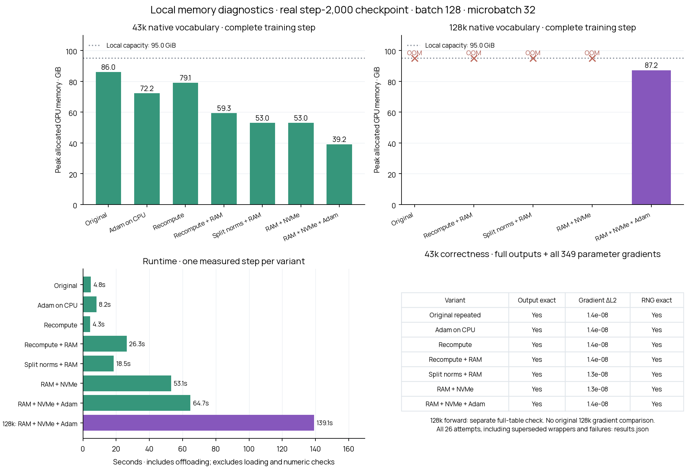

# Local training memory study

**A complete 128k-tokenizer training step fits in 87.24 GiB on the local GPU, using CPU and NVMe offloading. It takes about 139 seconds.** The running Modal trainer is unchanged. This is a memory study, not an evaluation of tokenizer quality.

## Main results

| Native vocabulary | Strategy | Outcome | Peak allocated GPU memory | Timed training phases |
|---|---|---|---:|---:|
| 43,000 | Original | Complete | 86.01 GiB | 4.82s |
| 43,000 | Temporarily move inactive Adam state to CPU | Complete | 72.19 GiB | 8.16s |
| 43,000 | Finer activation recomputation | Complete | 79.07 GiB | 4.34s |
| 43,000 | Finer recomputation + saved activations on CPU | Complete | 59.30 GiB | 26.31s |
| 43,000 | Split normalization + CPU/NVMe activations + CPU Adam | Complete | 39.15 GiB | 64.67s |
| 128,000 | Original | Out of memory | 86.00 GiB (incomplete) | 1.38s (incomplete) |
| 128,000 | Split normalization + CPU/NVMe activations + CPU Adam | Complete | 87.24 GiB | 139.13s |



[PDF plot](local_memory.pdf) · [All trial data](results.json)

Timings are single measured steps on an RTX PRO 6000 Blackwell Workstation Edition, with one process per trial. They include offloading and the real optimizer update, and exclude model loading, example preparation and numerical comparisons. They are not steady-state throughput measurements. Allocated GPU memory excludes unused allocator reservations; the raw records include reserved-memory peaks. Failed trials never establish a completed-step memory requirement.

## What was held constant

The user approved an exact local diagnostic copy, with the cloud originals retained. The checkpoint is `queues / anytok-pool-rl-20k / regret-run/step-002000`: the trained LM, hypernetwork, populated Adam optimizer, policy and RNG state. The original corpora and complete 1,000-tokenizer pool were downloaded and checksum-verified. Every trial restores that state in a separate process.

Memory trials use the complete native tokenizer #652 (43,000 entries) or #989 (128,000 entries), batch 128, four microbatches of 32 examples, corrected paired boundaries, and the original 128-position cap. All vocabulary entries and all original loss terms are retained, including lexical loss weight 0.5. The diagnostic forces one tokenizer instead of the policy action solely to compare implementations on identical work. It does not claim to have memory-tested every tokenizer in the pool.

**The 128-position cap applies to each LM example: BOS + prefix + continuation.** The continuation length remains the original variable length. A microbatch of 32 means 32 examples, not 32 scored tokens. Separately, the hypernetwork processes every vocabulary entry as ten source pieces plus a prior token, with hidden width 2,048. At vocabulary 128,000, one FP32 tensor of shape `128000 × 11 × 2048` alone occupies 10.74 GiB. Multiple such tensors and backward temporaries explain much of the peak.

All training-memory trials use PyTorch 2.15.0+cu132, matching the Modal PyTorch release. Local and Modal GPU models differ. Source hashes, input hashes, scored token/byte counts, phase timings and allocations are retained in results.json.

## What changed in the successful candidate

The isolated candidate recomputes attention, MLP and normalization at finer boundaries, preserving the original operators and dropout RNG. Saved activations can move to bounded CPU memory and then temporary NVMe files. Restoring them preserves values, shape, stride and storage offset. Inactive Adam tensors move to CPU during forward/backward and return to CUDA immediately before the unchanged fused Adam update. The final trials also use expandable allocator segments.

The successful 128k trial recorded 66.92 GiB of saved activations on CPU, plus 13.82 GiB of offloaded Adam tensors. These are not total process RAM measurements. Temporary NVMe storage peaked at 134.17 GiB across 2,209 files. The configured activation limits were 80 GiB host and 144 GiB disk. Temporary files were released after use. The full step completed canonical scoring, hypernetwork forward, all four LM forward/backward passes, lexical loss, hypernetwork backward, clipping and the actual Adam update.

**This is a capacity result with an expensive speed tradeoff.** RAM/NVMe offloading is not yet a suitable default for the remaining training run. A larger GPU may allow a faster RAM-only candidate, but H200 fit and throughput have not been measured. No Tillicum job or production migration has been launched.

## Correctness and limits

Complete 43k comparisons check all generated embeddings and all 349 gradient-bearing LM/hypernetwork parameters, before clipping. Every completed candidate has bit-identical generated outputs, losses and CUDA RNG versus the original. Gradients are not bit-identical: relative L2 differences are approximately 1.3–1.4e-8, comparable to repeating the unmodified baseline itself (1.35e-8). No nonfinite gradients were found. Nine focused tests cover operator/gradient behavior, dropout RNG, tensor layout, bounded offload, spill-file lifecycle and exact fused Adam state/parameter updates after CPU staging.

The separate [128k forward-equivalence check](forward-equivalence-128k.json) compares all 262,144,000 embedding elements using the same trained weights and training-mode dropout. Outputs and final RNG are bit-identical. Both comparison passes disable autograd, so this establishes forward equivalence only. The original full 128k training step OOMs locally; **there is no direct original-versus-candidate 128k gradient comparison**. The successful full training-memory trial is a separate measurement.

Early split-normalization diagnostic wrappers accidentally retained GPU tensors in Python closures just to access their dtype. This was a bug in the new diagnostic candidate, not the production trainer. The wrappers were corrected to capture scalar dtype values. All superseded attempts remain below; corrected trial IDs contain `fixed`. Source snapshots are archived by SHA-256 in source_versions/.

## Every attempt

| Trial | Outcome | Peak allocated GiB | Failure phase |
|---|---|---:|---|
| baseline-43k | complete | 86.01 |  |
| repeat-43k | complete | 86.01 |  |
| offload-43k | complete | 78.38 |  |
| fine-43k | complete | 79.07 |  |
| fine-offload-43k | complete | 59.30 |  |
| baseline-128k | out_of_memory | 86.00 | hypernetwork forward |
| offload-128k | out_of_memory | 84.26 | hypernetwork backward |
| fine-128k | out_of_memory | 92.59 | hypernetwork forward |
| fine-offload-128k | out_of_memory | 83.56 | hypernetwork forward |
| split-norm-43k | complete | 66.61 |  |
| split-norm-128k | out_of_memory | 80.14 | hypernetwork forward |
| fine-offload-43k-expand | complete | 59.29 |  |
| fine-offload-128k-expand | out_of_memory | 83.55 | hypernetwork forward |
| split-norm-43k-expand | complete | 66.60 |  |
| split-norm-128k-expand | out_of_memory | 90.91 | hypernetwork forward |
| split-disk-43k-expand | complete | 64.93 |  |
| split-disk-128k-expand | out_of_memory | 90.99 | hypernetwork forward |
| split-norm-fixed-43k-expand | complete | 52.97 |  |
| split-norm-fixed-128k-expand | out_of_memory | 94.10 | hypernetwork forward |
| split-disk-fixed-43k-expand | complete | 52.97 |  |
| split-disk-fixed-128k-expand | out_of_memory | 89.82 | hypernetwork backward |
| split-disk-fixed-43k-host80-expand | complete | 52.97 |  |
| split-disk-fixed-128k-host80-expand | out_of_memory | 89.82 | hypernetwork backward |
| optimizer-only-43k | complete | 72.19 |  |
| split-disk-fixed-43k-host80-optimizer-expand | complete | 39.15 |  |
| split-disk-fixed-128k-host80-optimizer-expand | complete | 87.24 |  |

## Reproduce

Use the exact local artifact tree described in scripts/download_local_memory_artifacts.py. Cloud originals remain authoritative; the local copy was a specifically approved exception. Build an isolated environment with PyTorch 2.15.0 and the project dependencies. The harness refuses a different PyTorch release.

```bash
.venv-memory/bin/python scripts/run_local_memory_experiments.py --resume
.venv-memory/bin/python scripts/verify_local_memory_forward.py
.venv-memory/bin/python scripts/report_local_memory.py
.venv-memory/bin/python -m pytest tests/test_local_memory_variants.py -q
```

The current harness reproduces the corrected implementation. Historical trial records retain their original source hashes; reproducing a superseded wrapper requires the corresponding archived source version. `--resume` preserves existing complete/OOM trials. Large checkpoints, corpora, tokenizer and gradient files are excluded from this report and Git. The running trainer never imports these diagnostic patches.
