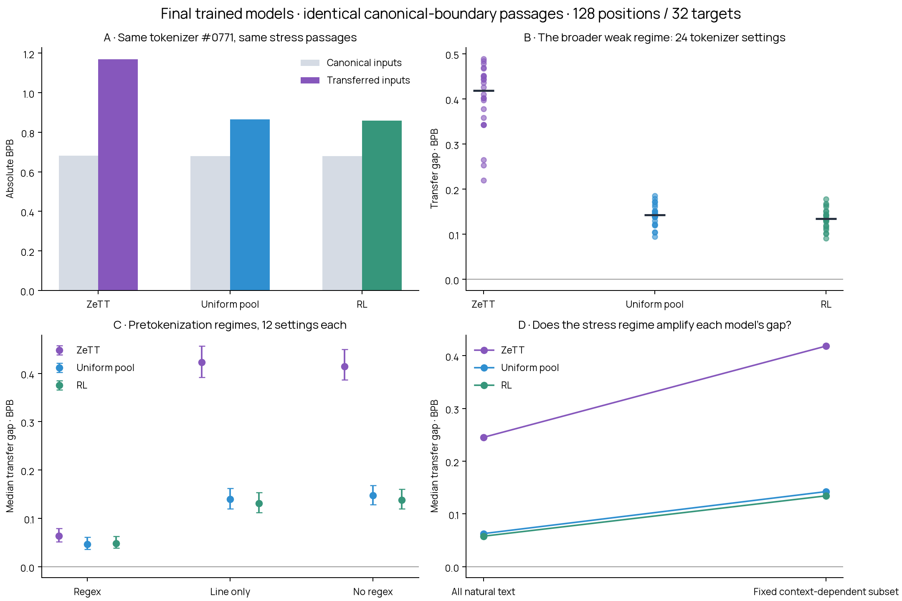

# Final trained models on the natural-text weakness regime

**The broad weak regime persists.** Across 24 line-only/no-regex tokenizer settings, the median confirmation transfer gap is **+0.418 BPB for ZeTT**, **+0.142 for uniform-pool training**, and **+0.134 for RL**. RL gaps range from +0.091 to +0.178 across these settings.

Uniform-pool training closes much of the original ZeTT model’s gap on this regime. RL adds a smaller improvement over uniform, while substantial residual transfer loss remains. Canonical scores are almost identical across the models here. All three models use the same corrected raw prefixes, canonical continuations and native tokenizers.

## The size of this setting

The fixed confirmation stress set contains **229 passages from 198 source documents**, **7,328 scored continuation tokens** and **23,074 scored UTF-8 bytes**. It is 22.5% of the 1,016 confirmation passages. Discovery contributes 251 passages from 203 separate documents. The source counts on confirmation are English web 54, code 61, math 57, medical 17 and legal 40.

This is a useful diagnostic panel, not a large benchmark or an estimate of the fraction of all internet text that fails. The selection rule can be applied to more held-out documents. It was fixed using RL’s canonical context benefit; membership is not recomputed for the other models. This model-dependent selection must be kept in mind when interpreting comparisons.

The tokenizer basin is line-only/no-regex pretokenization: 24 representative settings spanning all three algorithms and four vocabulary scales, with 12 regex settings as controls. In the original 1,000-pool metadata, 648 settings use line-only/no-regex splitting, including 206 with vocabulary at least 96k. These counts describe the settings region; they do not establish that every member has a large gap. There are also two previously weak controls 0003/0635. The comparison does not rescore all 1,000 tokenizers.

## Fixed tokenizer 0771: absolute loss and transfer gap

Tokenizer 0771 is WordPiece/no-regex/127k, selected using RL discovery documents before this comparison. Every row below uses exactly the same 229 confirmation passages. Lower BPB is better.

| Trained model | Canonical BPB | Transferred BPB | Gap | Paired 95% interval for gap |
|---|---:|---:|---:|---:|
| ZeTT 20k | 0.68044 | 1.16970 | +0.48926 | [+0.45203, +0.52938] |
| Uniform pool 20k | 0.67984 | 0.86476 | +0.18491 | [+0.16245, +0.21015] |
| RL 20k | 0.68029 | 0.85804 | +0.17775 | [+0.15328, +0.20681] |

The canonical baseline belongs to each trained LM. A lower gap does not by itself imply lower absolute loss: the LM’s canonical quality can change too. Absolute BPB and gap are both reported.

## Does the broader tokenizer regime have headroom?

| Model | Median regex gap (12) | Median line-only gap (12) | Median no-regex gap (12) | Median weak-regime gap (24) |
|---|---:|---:|---:|---:|
| ZeTT 20k | +0.06378 | +0.42323 | +0.41399 | +0.41835 |
| Uniform pool 20k | +0.04662 | +0.13971 | +0.14713 | +0.14240 |
| RL 20k | +0.04858 | +0.13151 | +0.13821 | +0.13437 |

Each entry first averages BPB within each source domain, then averages the five source scores equally for each tokenizer, and finally takes the median across the specified finite tokenizer group. It is not a median across individual passages.

## Paired RL effects on the same stress passages

The following differences average equally across the 24 weak-pretokenization settings. Negative changes favor RL. Intervals resample paired source-document clusters within domains; two passages from one source document always move together.

| Comparison | Absolute transferred BPB change | Paired 95% interval | Transfer-gap change | Paired 95% interval |
|---|---:|---:|---:|---:|
| RL minus Uniform pool 20k | -0.00764 | [-0.01185, -0.00295] | -0.00809 | [-0.01236, -0.00320] |
| RL minus ZeTT 20k | -0.26594 | [-0.28480, -0.24709] | -0.26579 | [-0.28531, -0.24585] |

## Setup and verification

The final checkpoints are the 20k ZeTT-sampled-tokenizer run, the 20k uniform 1,000-pool run and the 20k shared-settings RL run, each consisting of a trained SmolLM2-1.7B backbone and input hypernetwork. The original canonical input embedding table and canonical output head are frozen and verified equal to the original model. This comparison does not run training.

All 38 native tokenizers and the entire 2,032-passage corrected parent panel are reused. Each example contains BOS, an identical raw prefix encoded canonically or natively, and exactly 32 canonical continuation targets. Total positions are at most 128. All cuts preserve joint canonical tokenization. The hypernetwork reads the complete native vocabulary, with checksum-verified priors and surface features. Every batch’s per-token loss matches the model’s built-in causal loss. New weights are verified against their original step 20k manifests; all large transfers occur cloud-to-cloud. Inference uses at most two B300 workers and no explicit CPU/memory reservations.

We keep the original RL results unchanged. Context-dependent membership is pinned to 480 original passage IDs across both splits, selected by RL-canonical prefix benefit and excluding image-link markup. We also report the unfiltered panel as a control. The paired bootstrap uses 2,000 replicates and accounts for source documents, but not model-training seeds or trying multiple subgroups. There is only one trained seed per method.

## Reproduction and artifacts

- `results.json.gz`: complete per-passage loss totals, frozen passage metadata, tokenizer settings, checkpoint hashes and fixed subset membership. Each loss total sums 32 saved token losses in float64. This is sufficient to reproduce every aggregate and confidence interval here.
- `analysis.json`: per-tokenizer scores, cohort summaries, sizes and paired model comparisons.
- `metrics.csv`: absolute losses and gaps for each model/tokenizer/split/text setting.
- `model_comparison.png` and `.pdf`: matched model plots.
- `manifest.json`: SHA-256 hashes and sizes.

Run `python scripts/analyze_natural_model_comparison.py --input reports/natural-model-comparison-20k/results.json.gz --output /tmp/model-comparison-reproduced` from the repository. The cloud entry point is `scripts/modal_natural_model_comparison.py`; the frozen plan is `plans/natural-model-comparison-v1.json`.

Raw corpora, checkpoint weights, exact raw-text panel and full per-token scores remain in persistent Modal storage: blackpantherx86 / anytok-rl-all-pool-20k / natural-model-comparison-v1/. The corrected parent panel and original RL scores are in natural-transfer-aligned-v2/. Only score metadata and figures pass through the local caller.
