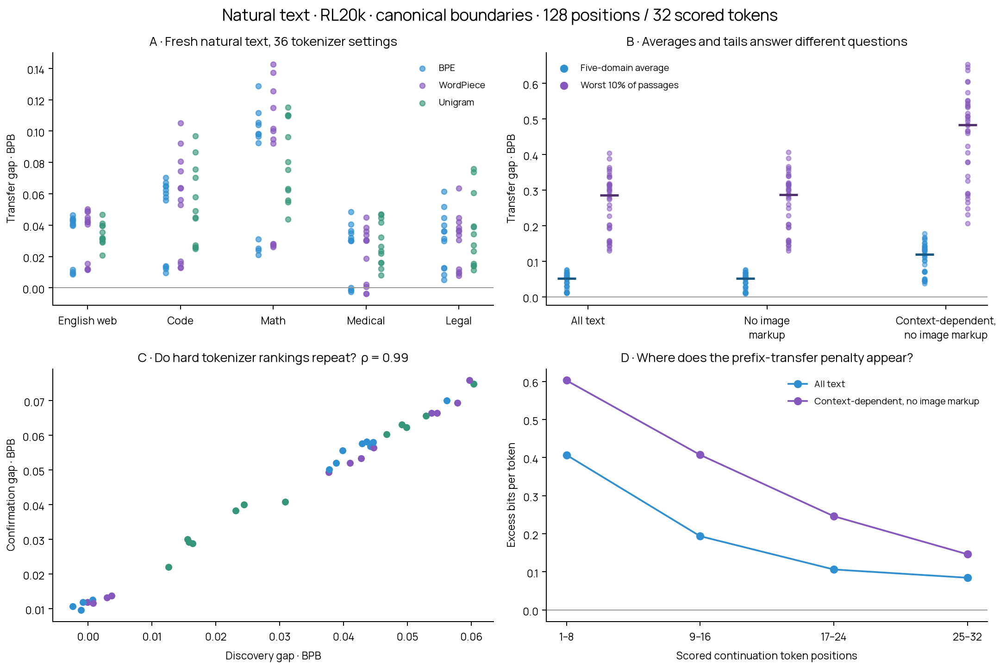
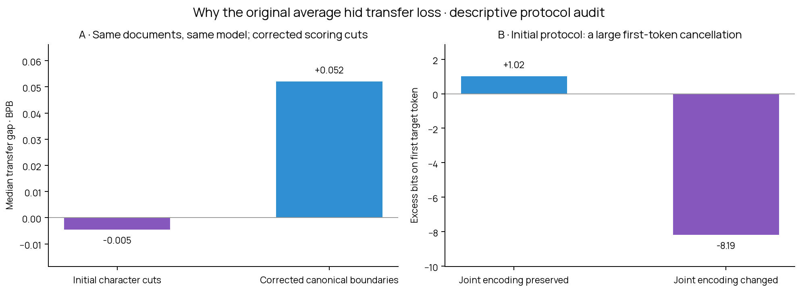

# Natural-text transfer gaps: is there a useful adversarial tokenizer signal?

This tests the final RL20k model on ordinary held-out text, with cuts that preserve normal canonical tokenization. No new training or synthetic copying prompts are used.

Across 36 settings selected by generator configuration, the median five-domain confirmation gap is **+0.05205 BPB**. The median gap on each setting’s worst 10% of confirmation passages is **+0.28573 BPB**.

The tokenizer selected as hardest on discovery is **0192**. On independent confirmation documents it is **+0.03043 BPB** harder than uniform over these 36 settings; paired 95% interval **[+0.02650, +0.03430]**. Discovery/confirmation rank correlation is **0.991**.



## What these numbers mean

The checkpoint is SmolLM2-1.7B plus its input-embedding hypernetwork after 20,000 joint updates with the shared-settings tokenizer-selection policy. The LM backbone and hypernetwork were trained; the original canonical input table and canonical output head were frozen. This report evaluates that one checkpoint. [The original source specification](../rl-pool-sweep-20k/spec.json) records the model, checkpoint and native-tokenizer hashes.

A transfer gap is transferred BPB minus canonical BPB on exactly the same text. Both use the same trained LM and canonical output head; only prefix tokenization and prefix input embeddings differ. A positive gap is additional loss introduced by transfer. A difficult passage with high canonical loss is not automatically a transfer failure.

The average equally weights English web, code, math, medical and legal text. Within a domain, BPB is total negative log likelihood divided by total scored UTF-8 bytes and ln(2). Tail summaries first compute each passage’s gap, then average the worst 10% of passages equally. Thus the average and tail use different explicit weighting; the tail describes a minority of text and is not overall performance.

## Absolute BPB and the adversary’s opportunity

| Natural-text setting | Canonical BPB | Uniform expected transferred BPB | Discovery-selected hardest transferred BPB | Hardest transfer gap |
|---|---:|---:|---:|---:|
| All natural text | 0.70812 | 0.75252 | 0.78295 | +0.07483 |
| Exclude image-link markup | 0.70813 | 0.75233 | 0.78369 | +0.07556 |
| Context-dependent; exclude image markup | 0.68029 | 0.78779 | 0.85804 | +0.17775 |

Uniform means a uniform draw from the 36 evaluated representative settings. It is not a second model trained with uniform sampling. The selected setting was chosen on discovery; these scores are on confirmation. All columns use equal domain weights.

The context-dependent setting contains **229 confirmation passages from 198 documents**. Its discovery-selected tokenizer is **0771**, wordpiece, no-regex, requested vocabulary 127,000. Its **+0.17775 BPB** gap has paired 95% interval **[+0.15328, +0.20681]**. This is an average over that natural-text setting, not the maximum individual passage.

## Confirmation aggregates

| Text setting | Passages / documents | Median average gap | Min–max average gap | Median worst 10% gap | Median fraction above+.1 BPB |
|---|---:|---:|---:|---:|---:|
| All natural text | 1016 / 508 | +0.05205 | +0.00964–+0.07585 | +0.28573 | 23.6% |
| Exclude image-link markup | 1000 / 506 | +0.05216 | +0.00846–+0.07676 | +0.28754 | 23.8% |
| Context-dependent; exclude image markup | 229 / 198 | +0.11876 | +0.03741–+0.17775 | +0.48369 | 43.7% |
| English web | 256 / 128 | +0.03963 | +0.00858–+0.05024 | +0.16155 | 11.3% |
| Code | 256 / 128 | +0.05702 | +0.00942–+0.10521 | +0.20585 | 25.2% |
| Math | 256 / 128 | +0.09548 | +0.02095–+0.14262 | +0.45138 | 39.6% |
| Medical | 56 / 28 | +0.03010 | -0.00376–+0.04838 | +0.32562 | 17.9% |
| Legal | 192 / 96 | +0.03406 | +0.00505–+0.07591 | +0.17117 | 14.6% |
| Image-link markup | 13 / 12 | +0.02770 | +0.00262–+0.04923 | +0.12216 | 7.7% |
| Structured rows | 215 / 165 | +0.04941 | +0.01358–+0.07452 | +0.23471 | 24.4% |
| At least 8% digit characters | 54 / 48 | +0.12760 | +0.04829–+0.21016 | +0.56958 | 57.4% |
| A number repeats from prefix to continuation | 30 / 28 | +0.11312 | +0.04452–+0.16803 | +0.41041 | 55.0% |
| Plain prose (heuristic) | 583 / 347 | +0.04043 | -0.00022–+0.06037 | +0.26874 | 19.8% |

Medians/minima/maxima are across 36 representative settings, not across documents or all 1,000 pool members. The two previously weak controls 0003/0635 are included in the data but excluded from these summaries. Tags overlap. Numeric density means at least 8% digit characters; repeated numbers means a suffix number containing at least three consecutive digits also appears in the prefix. Structured text is detected by fixed punctuation/row patterns. Image-link markup is retained and also removed in the named sensitivity.

Rare-tag comparisons retain only source domains with examples in both discovery and confirmation, so domain weighting does not silently change between cohorts. Domain coverage is listed in analysis.json. These overlapping subgroups are exploratory; small groups should not be treated as broad population estimates.

## Does selecting hard tokenizers generalize?

Choose the hardest setting on discovery, then measure its gap on confirmation. The reference is the mean gap from uniformly choosing among the 36 evaluated representative settings. This is an offline selection test, not a trained RL policy or a comparison with uniform-trained model weights.

| Setting | Discovery-selected tokenizer | Confirmation selection advantage | Paired 95% interval | Rank correlation |
|---|---:|---:|---:|---:|
| All natural text | 0192 | +0.03043 | [+0.02650, +0.03430] | 0.991 |
| Exclude image-link markup | 0192 | +0.03136 | [+0.02700, +0.03607] | 0.990 |
| Context-dependent text | 0771 | +0.06918 | [+0.05609, +0.08524] | 0.970 |
| Context-dependent; exclude image markup | 0771 | +0.07025 | [+0.05648, +0.08731] | 0.973 |
| English web | 0443 | +0.01529 | [+0.01179, +0.01885] | 0.970 |
| Code | 0771 | +0.05440 | [+0.04685, +0.06181] | 0.989 |
| Math | 0443 | +0.05585 | [+0.04431, +0.06841] | 0.971 |
| Medical | 0806 | +0.01424 | [+0.00343, +0.02505] | 0.828 |
| Legal | 0192 | +0.04360 | [+0.03661, +0.05114] | 0.984 |
| Image-link markup | 0806 | +0.00914 | [-0.00459, +0.02450] | 0.549 |
| Structured rows | 0771 | +0.02824 | [+0.01999, +0.03787] | 0.933 |
| At least 8% digit characters | 0912 | +0.07352 | [+0.02910, +0.15398] | 0.962 |
| A number repeats from prefix to continuation | 0004 | +0.02920 | [+0.01490, +0.04704] | 0.896 |
| Plain prose (heuristic) | 0192 | +0.02721 | [+0.02182, +0.03299] | 0.979 |

Allowing a different discovery-selected setting for each domain gives a confirmation advantage of **+0.03668 BPB**, with paired 95% interval [+0.03294, +0.04064]. This is a contextual selector that knows the source domain; our previous settings-only policy did not condition on text/domain.

A positive, repeatable selection advantage is the useful signal for an adversarial tokenizer policy. A large tail shared by every tokenizer instead motivates finding hard text. A high tail alone does not show that selecting tokenizers is valuable. The top 20% selection sensitivity and a descriptive tokenizer/passage/interaction variance decomposition are in analysis.json.

## Context and scoring, explicitly

Each example is BOS + raw prefix + 32 canonical continuation tokens, with at most 128 positions total. Prefixes start at at most 64 canonical tokens and are jointly shortened only if necessary for all 38 native encoders; at least 16 canonical prefix tokens remain. The native prefix can have a different number of tokens, but every setting sees identical raw prefix text and identical scored continuation IDs/bytes. Teacher forcing supplies earlier canonical continuation tokens, so later positions can rely less on the transferred prefix. Panel D shows excess bits/token in successive eight-token blocks; it does not assign invented byte boundaries to individual tokens.

```text
Canonical: BOS (1) | raw prefix as ≤64 canonical tokens | 32 scored canonical tokens
Transfer:  BOS (1) | same raw prefix as ≤95 native tokens | same 32 scored canonical tokens
```

For the context-dependent stratum, score the same continuation with BOS alone and with its canonical prefix. Context benefit is BOS-only BPB minus canonical-prefix BPB. For each domain, freeze the 75th-percentile discovery threshold and apply that numerical threshold to confirmation. This uses only canonical losses, never transferred losses, and changes no text. It is a diagnostic stratum, not the original training distribution.

## Data independence and verification

The panel contains 2,032 passages from 1,016 source documents. Each split has 1,016 passages from 508 documents: 128 documents each for web/code/math, 96 legal and 28 medical documents, with two disjoint source windows per document. We use deterministic ID hashing and deterministic locations in opposite halves of each full document. Documents must contain at least 1,024 characters to support both windows; this excludes shorter documents and limits the population represented. All source IDs from the previous all-pool evaluation are excluded. Discovery/confirmation source IDs and full-document text hashes are disjoint. Initial document-eligibility rejections are in initial-results.json.gz; the corrected alignment rejects no surviving passage. Every surviving passage ID/hash is in results.json.gz. The five-domain average compensates for unequal domain sample counts; the pooled passage tail retains those sample counts.

All model/checkpoint/tokenizer/feature checksums are verified in the cloud. Hypernetwork inference uses the complete native vocabulary. Canonical input/output tables remain equal to their original values. Every batch’s per-token loss agrees with the model’s built-in causal loss, and canonical/BOS-only per-token losses agree exactly across workers. Confidence intervals resample paired document clusters within domains, so the two windows from one document move together. There are 2,000 replicates. Intervals condition on the chosen discovery setting and one trained model; they do not cover model-training seeds or correct for trying multiple subgroups.

## Files and reproduction

- `results.json.gz`: frozen plan, passage metadata, full paired 32-token losses for all 38 settings and canonical/BOS-only controls.
- `analysis.json`: all aggregates, paired intervals, held-out selection tests, context thresholds and example requests.
- `metrics.csv`: per-setting, per-split, per-subgroup metrics.
- `natural_transfer.png` / `.pdf`: four-panel results.
- `manifest.json`: SHA-256 checksums and file sizes.

Run `python scripts/analyze_natural_transfer.py --input reports/natural-transfer-20k/results.json.gz --output /tmp/natural-transfer-reproduced` from the repository. The cloud launcher is `scripts/modal_natural_transfer.py`; design and selection are frozen in `plans/natural-transfer-v1.json` and the correction in `plans/natural-transfer-aligned-v2.json` and `.md`. Raw corpora, full raw-text panels, tokenizer files and model weights remain in persistent Modal storage: `blackpantherx86 / anytok-rl-all-pool-20k / natural-transfer-aligned-v2/` and `natural-transfer-v1/`.

This is a balanced five-source English/code diagnostic and a stratified tokenizer subset, not an estimate for arbitrary internet text or every possible tokenizer. It does not establish that continuous generation helps, that RL training beats uniform training, or a causal mechanism for any failure.

## Why the original averages looked misleading

The initial character-cut protocol preserved normal canonical tokenization at only **579/2032 cuts**. At the other cuts, separately encoding the prefix and suffix creates a different canonical token sequence from encoding their concatenation normally. The initial per-token losses show a large transferred advantage on the first target token at these mismatched seams, offsetting penalties later in the continuation.

The main results above correct this: every cut preserves joint canonical tokenization. We kept all documents, splits and source windows, moving **1453 cuts** by at most **27 Unicode characters**. No passage was chosen or replaced based on its model loss. The correction was motivated by inspecting the initial evaluation, so this is a protocol correction on the same documents, not a fully blind new study.

The initial scores are preserved in `initial-results.json.gz`; the encoding audit is `boundary-audit.json`. Full audit statistics and token-position curves are in analysis.json. The target strings move slightly with the cuts, so compare transferred and canonical losses within a version. The change between versions is not model improvement.



## How this connects to adversarial training

The relevant quantity is the held-out selection advantage, not merely a high loss on a few passages. Repeatable ranking and a positive advantage show that tokenizer choice supplies an adversarial signal on this frozen model. They do not yet show that adversarial training improves generalization.

The next controlled experiment should apply this corrected scoring rule to separate training-side natural text, give the tokenizer policy paired transfer-gap rewards, preserve explicit exploration, and compare against uniform sampling at the same model-update budget. The canonical-only context-benefit rule provides a natural-text stress distribution; keep an ordinary-text evaluation alongside it. Leave this report’s held-out passages out of training. Refresh the search as the model changes. Continuous tokenizer generation can follow once selecting hard settings from the existing pool demonstrates a training benefit.

## Inspectable natural passages

See [examples.json](examples.json) for ten actual prefix/continuation pairs: two per source with large average transfer gaps on confirmation, excluding image markup. These are selected illustrations, not independent evidence or a prevalence estimate. Their scores are already included in the complete aggregates above.
