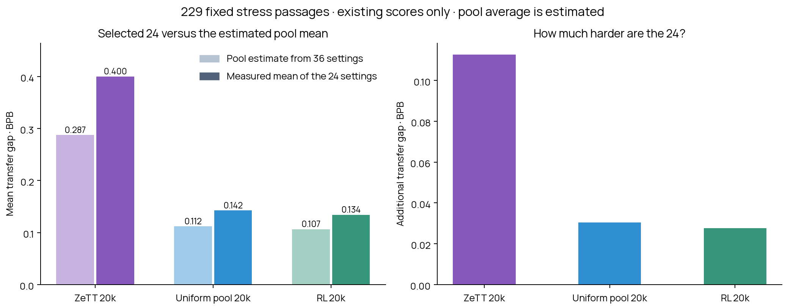

# Selected 24 versus an estimated average pool tokenizer

**No new GPU evaluation.** The full sweep was cancelled at the user’s request. This is a quick reference based on existing scores for 36 representative pool tokenizers, reweighted to match the composition of the 1,000-member pool.

| Model | Estimated pool mean gap | Measured 24 mean gap | Additional gap for the 24 |
|---|---:|---:|---:|
| ZeTT 20k | +0.28743 | +0.40008 | +0.11265 |
| Uniform pool 20k | +0.11188 | +0.14238 | +0.03050 |
| RL 20k | +0.10662 | +0.13429 | +0.02767 |

These are arithmetic means across tokenizers, not the medians reported previously. Every score uses the same 229 context-dependent confirmation passages from 198 documents. For each tokenizer, BPB is byte-weighted within source domains and the five sources receive equal weights.

To estimate the full pool average, assign each of its 1,000 tokenizers to the closest vocabulary-size representative with the same algorithm and pretokenizer. The 36 representatives cover all nine algorithm/pretokenizer combinations and four vocabulary scales. Weight their measured scores by the number of assigned pool members.

**This is not the measured full-pool mean.** The representatives were selected by configuration, not sampled uniformly at random. The estimate ignores domain-mixture, BPE-noise and seed differences among tokenizers assigned to the same representative. Treat it as a settings-based reference, not a precise population estimate. The exact unweighted mean of the 36 is also saved in analysis.json.

The input score table, pool settings and source checksums are in inputs.json; all 1,000 assignments and 36 weights are in analysis.json. The original paired model results remain in ../natural-model-comparison-20k/.

Reproduce with `python scripts/analyze_pool_reference.py --input reports/pool-reference-estimate/inputs.json --output /tmp/pool-reference`.
