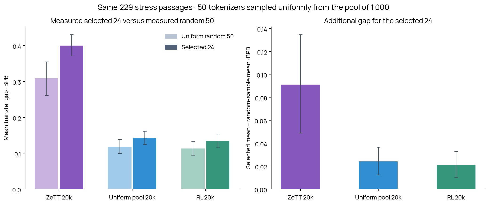

# Selected 24 versus a uniform random sample of 50

**The reference is measured, not imputed from representative settings.** Fifty distinct IDs were drawn uniformly without replacement from all 1,000 pool members using seed 20261117, committed before scoring. The selected 24 were not excluded. The draw overlaps that group at 0011 and 0912, giving 72 distinct settings scored on all three trained models.

| Model | Random 50 mean gap | Selected 24 mean gap | Additional gap | 95% interval for additional gap |
|---|---:|---:|---:|---:|
| ZeTT 20k | +0.30896 | +0.40008 | +0.09113 | [+0.04884, +0.13473] |
| Uniform pool 20k | +0.11835 | +0.14238 | +0.02403 | [+0.01241, +0.03657] |
| RL 20k | +0.11322 | +0.13429 | +0.02108 | [+0.01039, +0.03288] |

The random sample also has substantial transfer loss on these passages. The selected 24 have a higher mean gap for all three models; for RL the additional gap is about +0.021 BPB. These results support a broader weakness on this text subset, rather than one confined to the selected settings.

**Gap means transferred BPB minus that model’s trained canonical BPB on the identical continuations. Lower is better; zero means matching the trained canonical baseline.** The random-sample columns measure an actual sample mean, without settings-based weighting.

These are arithmetic means across tokenizers, not medians. Each tokenizer’s BPB is byte-weighted within source domains and then equally averaged over the five domains. Every row uses the same 229 previously selected context-dependent confirmation passages from 198 source documents, scoring 7,328 canonical target tokens and 23,074 UTF-8 bytes. The prefix is input only; the next 32 canonical tokens are scored under teacher forcing, with at most 128 positions including BOS.

Joint encoding validation required shortening **0 prefixes**. All randomly selected settings were retained. Document IDs, cuts and scored continuation bytes are unchanged. All 72 settings, including the selected 24, are rescored on the shared prefixes; historical scores are not mixed into this comparison.

The sample mean is an estimate of the full-pool mean, based on an actual uniform sample. It is not the measured mean of all 1,000 tokenizers. The selected 24 are a fixed configuration-selected group. Uncertainty combines paired document-cluster resampling within domains with resampling of the random 50 IDs; tokenizer-sampling deviations use the finite-population correction. Shared random IDs and source draws preserve pairing between models. Intervals do not cover model-training seeds.

The random sample’s settings distribution and exact IDs are in analysis.json. The committed draw and checkpoint hashes are in the plan inside results.json.gz. The same original trained canonical embedding tables and output heads are verified for each model. Every batch’s token loss agrees with Hugging Face’s built-in causal loss. Native embeddings are generated from complete vocabularies and checksum-verified feature arrays.

The text subset was defined using the earlier RL-canonical context-benefit diagnostic and is fixed across models. It is a stress set, not a prevalence estimate for arbitrary text. The former 36-setting proxy is superseded and removed from the active dashboard and report folder.

Reproduce with `python scripts/analyze_random_pool_50.py --input reports/random-pool-50/results.json.gz --output /tmp/random-pool-50`.

Full native tokenizer files, raw prefixes, checkpoints and per-token losses remain in persistent cloud storage: blackpantherx86 / anytok-rl-all-pool-20k / random-pool-50-v1/. The report stores all per-passage loss totals needed to reproduce the aggregates and confidence intervals.
