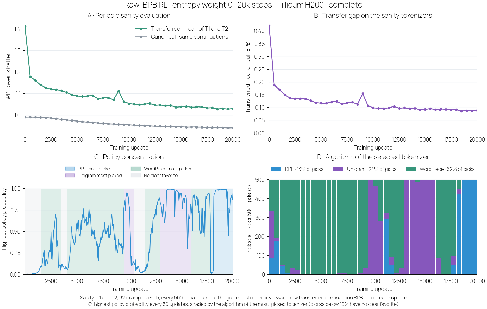

# Raw-BPB RL · entropy weight 0 · 20k steps on Tillicum

**Complete: 20,000 of 20,000 updates.** Mean transferred sanity BPB over T1 and T2 fell from **1.411** to **1.030** (27% lower), and the gap to canonical from **+0.421** to **+0.089 BPB**; canonical BPB went from 0.990 to 0.941. 75% of the transferred-BPB drop came in the first 2,000 updates.

This is the raw-BPB counterpart of the regret run (`anytok-pool-regret-rl-training`): the same inputs, as packaged by the handoff bundle, corrected paired boundaries, entropy weight 0 and sanity evaluation, with the raw transferred BPB instead of the paired gap as the policy reward. The regret run's configuration in [plans/four-way-8k-v1.json](../../plans/four-way-8k-v1.json) has the same `fixed_eval_sha256`, `pairing_protocol`, paired-reward source, pool, corpus and recipe hashes as this run, so the two sanity curves can be compared update by update through update 8,000, where the regret run is paused. This sanity curve is not directly comparable with the uniform run's ([Limits](#limits)). This is also not the entropy-0.01 “Raw-BPB RL” run of the [four-way 8k evaluation](../../plans/four-way-8k-evaluation.md).

[PDF](raw_bpb_rl_20k_tillicum.pdf) · [Sanity evaluation](sanity.csv) · [Most-picked tokenizers](most-picked.csv) · [Checkpoints](checkpoints.csv) · [Jobs](jobs.csv) · [Analysis](analysis.json) · [Run tables](run-tables.json) · [Run plan](../../plans/raw-bpb-rl-20k-tillicum.md)

## Run

- Trainer `runtime/anytok_pool_raw_bpb_rl_20k` and launcher `scripts/run_raw_bpb_training.py` from the raw-BPB handoff ([docs/raw-bpb-handoff](../../docs/raw-bpb-handoff), commit 670993b), with the input bundle it pins: Hugging Face dataset `cminst/anytok-training-inputs`, revision `c2421b0c`. All source and input hashes in [run_config.json](run_config.json) and its policy settings equal those of the handoff verification, and `pool_plan_sha256` equals [plans/tokenizer-pool-1000-v1.json](../../plans/tokenizer-pool-1000-v1.json). The committed `run_config.json` replaces the cluster username in two input paths with `<user>`.
- Policy reward: the raw transferred continuation BPB of the update's 128 paired training examples, measured before the model update (`paired_pre_model_update_transferred_bpb`). Entropy weight 0.
- The 20,000 updates are the start of the 190,000-update learning-rate schedule, as in the uniform run: a 10,000-update ramp, then cosine decay. At update 20,000 the hypernetwork learning rate was 99.3% of its peak.
- UW Hyak Tillicum, one H200 per job, in chained 24-hour Slurm jobs from 2026-11-15 to 2026-11-17 UTC; 39.9 GPU-hours in all. The cluster wrappers are on the `hyak-tillicum-port` branch of the fork [Dekiofsa/anytok](https://github.com/Dekiofsa/anytok/tree/hyak-tillicum-port/hyak).
- The first attempt crashed while saving update 5,000, when the cluster's shared scratch file system was over its quota. The run resumed from the update-4,000 full restart, copied to project storage. Redoing updates 4,001–5,000 took about 1.9 GPU-hours.
- The replay was not bit-identical. Apart from per-update wall-clock time, every logged training value of the 1,000 replayed updates matched the first attempt through update 4,031; losses first differed at 4,032, and from 4,091 the policy drew a different tokenizer in 296 of the 1,000 replayed updates. The event log keeps both versions; these tables use the last row for each update, which is the trajectory the run kept.
- The first restart job was signaled before its 24-hour limit, finished its update, ran the sanity evaluation and saved a full restart at update 16,409 (a graceful stop); the second job resumed from it.

## Periodic sanity evaluation

Every 500 updates and at the graceful stop, the trainer scores the two fixed ZeTT sanity tokenizers T1 and T2 (`uniform_heldout_tokenizers.json` in the bundle, 32,768 entries each, not in the pool). For each tokenizer, `build_eval_set` takes 92 examples, 4 from each of the 23 held-out buckets: each window is shortened from 240 down to 80 characters, or the next document is used, until a cut near the middle passes the paired checks and fits in 128 positions. The prefix is read through the sanity tokenizer and the continuation is scored in canonical tokens, so T1 and T2 score different bytes: 10,421 and 10,575. The step-0 values reproduce the handoff's H200 verification exactly (`docs/raw-bpb-handoff/training-verification.json`).

Changes between evaluations, such as the rise at update 9,000, are real changes on this fixed text, not measurement noise, but they rest on only about 10,500 scored bytes per tokenizer.

## Policy

Panel C shows the highest policy probability, read every 50 updates. It reached **99.4%** at update 13,950, stayed at or above 95% for most of updates 13,600–14,750 and 18,300–19,450, and ended at 97.9%. Over the run the policy drew **669** different tokenizers, 537 of them in the first 1,500 updates. No tokenizer stayed the most-picked for longer than 3,000 updates (#103, 6,501–9,500).

| Updates | Most picked | Algorithm / pretokenizer / vocab | Share of picks | Hardness rank, regret | Hardness rank, raw BPB |
| --- | --- | --- | ---: | ---: | ---: |
| 1–1,500 | No clear favorite | | | | |
| 1,501–2,000 | #771 | WordPiece / no-regex / 127k | 17% | 323 | 389 |
| 2,001–2,500 | #103 | WordPiece / no-regex / 127k | 16% | 247 | 314 |
| 2,501–3,500 | #771 | WordPiece / no-regex / 127k | 31% | 323 | 389 |
| 3,501–4,000 | No clear favorite | | | | |
| 4,001–5,500 | #103 | WordPiece / no-regex / 127k | 37% | 247 | 314 |
| 5,501–6,500 | #771 | WordPiece / no-regex / 127k | 62% | 323 | 389 |
| 6,501–9,500 | #103 | WordPiece / no-regex / 127k | 39% | 247 | 314 |
| 9,501–10,500 | #170 | Unigram / no-regex / 125k | 61% | 4 | 8 |
| 10,501–11,500 | No clear favorite | | | | |
| 11,501–13,000 | #314 | WordPiece / line256 / 125k | 50% | 158 | 202 |
| 13,001–15,500 | #170 | Unigram / no-regex / 125k | 88% | 4 | 8 |
| 15,501–16,000 | #792 | Unigram / no-regex / 113k | 51% | 50 | 57 |
| 16,001–17,000 | #771 | WordPiece / no-regex / 127k | 71% | 323 | 389 |
| 17,001–18,000 | #873 | WordPiece / no-regex / 125k | 61% | 243 | 308 |
| 18,001–20,000 | #824 | BPE / no-regex / 127k | 87% | 582 | 612 |

A 500-update block has a most-picked tokenizer only if it got at least 10% of the block's picks; neighboring blocks with the same one are joined. The hardness ranks (1 = hardest of the 1,000) come from the [regret run's step-6,500 ranking](../regret-pool-ranking-6500/README.md), which measured a different model: the first orders tokenizers by mean regret, as that report does, and the second orders the same measurements by raw BPB, this run's reward. Neither describes this run's own model.

Over the run, 62% of selections were WordPiece, 24% Unigram and 13% BPE (rounded), while the pool holds 328 WordPiece, 340 Unigram and 332 BPE tokenizers. Every most-picked tokenizer had a vocabulary of 113k–127k, and all but #314 use the no-regex pretokenizer.

## Jobs

| Job | What it did | Slurm state | GPU-hours |
| --- | --- | --- | ---: |
| Smoke test (473379) | A 3-update test before the real run | COMPLETED | 0.05 |
| First attempt, job 1 (473452) | Updates 1–5,000; crashed while saving update 5,000 | FAILED | 9.33 |
| First attempt, job 2 (473453) | Exited at once because job 1 had failed | FAILED | 0.00 |
| First attempt, job 3 (473454) | Exited at once because job 1 had failed | FAILED | 0.00 |
| Restart, job 1 (481232) | Updates 4,001–16,409 from the update-4,000 restart; graceful stop | COMPLETED | 23.67 |
| Restart, job 2 (481233) | Updates 16,410–20,000 | COMPLETED | 6.83 |
| Restart, job 3 (481234) | Third queued job, canceled before it started | CANCELLED | 0.00 |
| **Total** | | | **39.9** |

Start and end times (UTC) are in [jobs.csv](jobs.csv).

## Limits

- **Not directly comparable with the uniform run's sanity curve.** Both trainers cut each sanity passage once and use that cut for the sanity tokenizer and the canonical control, but in different places. The uniform trainer cuts at the exact middle character, even inside a word or a canonical token (`make_split_prefix_example` in `runtime/anytok_pool_20k/hf_hypernet/joint_training.py`). This trainer moves the cut to the nearest canonical token boundary that passes its reversibility checks (`make_paired_prefix_example` in `runtime/anytok_pool_regret_rl_20k/hf_hypernet/paired_reward.py`, which `scripts/run_raw_bpb_training.py` stages into this trainer). Already at step 0 the uniform run scored 10,452 and 10,610 bytes with canonical BPB 1.063 and 1.061 ([sanity.csv](../rl-tokenizer-selection-20k/data/training/sanity.csv)), against 10,421 and 10,575 bytes with 0.990 and 0.991 here.
- **No final evaluation yet.** Only an evaluation that scores the models the same way can rank this run against the others. The regret run has no model past update 8,000, so the like-for-like comparison with it is this run's update-8,000 full restart scored with the four-way 8k panel; against the uniform run, both final 20k models can be scored.
- **The hardness ranks describe another model.** This run's own model has not been scored on all 1,000 tokenizers, so it is unknown whether its most-picked tokenizers were the hardest ones for it.
- One run and one seed; the learning rate is still near its peak at update 20,000.

## Checkpoints and reproduction

The 42 checkpoints (every 500 updates, plus 16,409), the event log, the final status and the run configuration are on Hugging Face at a pinned revision: [Dekiofsa/RLtokenizers · raw-bpb-rl-20k](https://huggingface.co/Dekiofsa/RLtokenizers/tree/2e2cf342a0622ba539c774837b595f84af29ec82/raw-bpb-rl-20k). Each checkpoint holds `lm.pt`, `hypernet/`, `policy.pt` and a `manifest.json` with the size and SHA-256 of every file; the 12 full restarts (0, 2,000, …, 20,000 and 16,409) also hold `state.pt` and `optimizer.pt`. [checkpoints.csv](checkpoints.csv) lists the SHA-256 of each `manifest.json`. On 2026-11-18 UTC the 239 run files (the 42 checkpoint folders plus `events.jsonl`, `status.json`, `initial_eval.json`, `heldout_tokenizers.json` and a package list) were downloaded again from that revision and matched the cluster copy. The redacted `run_config.json` was uploaded separately and checked against its local copy.

`run-tables.json` is the output of `scripts/extract_raw_bpb_rl_20k_tillicum.py`, run read-only on the cluster, and `status.json` is the run's final status, which the dashboard entry `raw-bpb-entropy0-training` reads. Rebuild everything else here with `python scripts/report_raw_bpb_rl_20k_tillicum.py`; `tests/test_raw_bpb_rl_20k_tillicum.py` checks `analysis.json` against these inputs and the manifest against every file.
