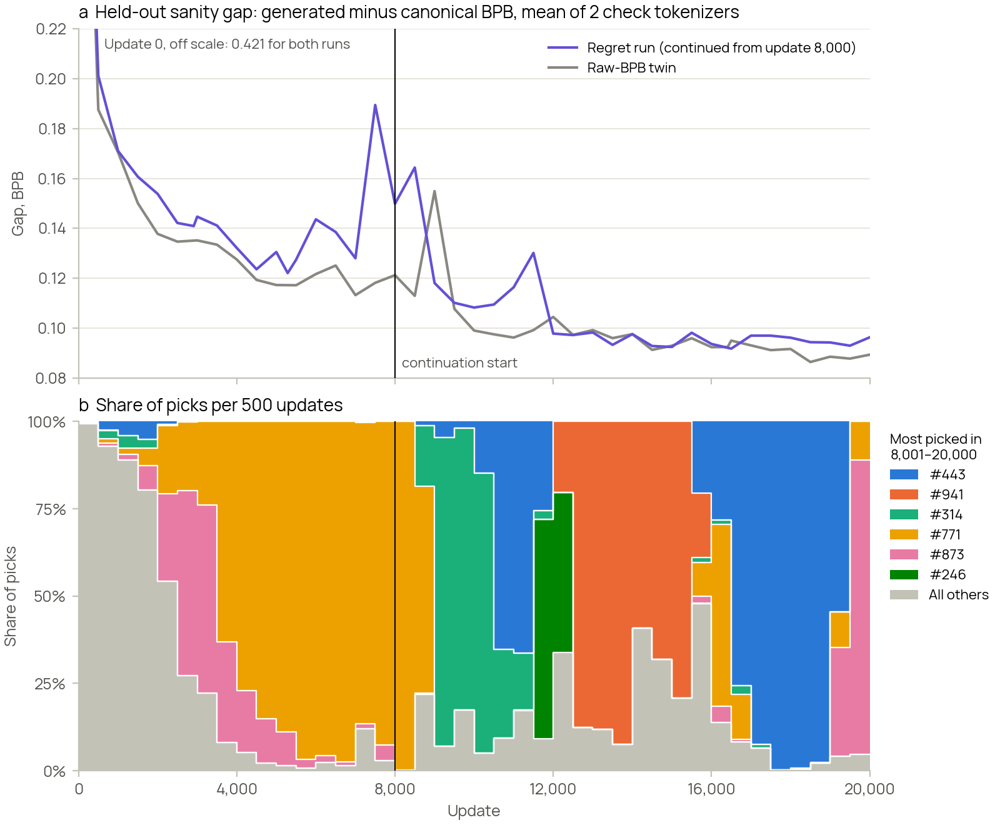

# Regret RL continuation: updates 8,001–20,000

Qingyun's entropy-0 regret RL run ([cminst/anytok-regret-rl-20k](https://huggingface.co/cminst/anytok-regret-rl-20k)) was continued from its step-8,000 full restart to update **20,000** in **one** Tillicum H200 allocation (job 505613, **22:50:25**). The trainer, inputs and training settings are the source run's, and update 8,001 reproduced the source run's logged tokenizer, paired batch, losses and reward exactly. The event log holds updates **1–20,000** once each, and the **24** new checkpoints (**6** full restarts) are on Hugging Face and match their manifests. The held-out sanity gap went from **0.1499** at update 8,000 to **0.0963** at 20,000 (raw-BPB twin: **0.1212** and **0.0894**). The training reward averaged **0.04307 BPB** over updates 18,001–20,000. With the resume check, the continuation used **22.873** H200 GPU-hours.

## What ran

- **Source run.** Updates 1–5,288 ran on Modal (B300) and 5,289–8,000 on Tillicum (H200), where the run paused. Its log records pauses at 2,912 and 5,288, and an `execution_migration` event at 5,288 ("Modal B300 to Tillicum H200; verified identical input artifacts and GPU-only memory fix") that also records the new trainer file (`training_script_sha256`).
- **Starting point.** The step-8,000 full restart at revision `89bbf8d4cb9f…` of cminst/anytok-regret-rl-20k, prefix `checkpoints/step-008000`, manifest SHA-256 `3829bc297ffd…`: 6 files, 23.47 GB, copied to Tillicum, where every file matched the size and SHA-256 in that manifest.
- **Unchanged.** The trainer (SHA-256 `c411e683c225…`), the input bundle (manifest SHA-256 `53d2968d9a1e…`) and every training setting: reward `paired_pre_model_update_transferred_bpb_minus_current_canonical_bpb` (objective regret), a `shared_settings_mlp` policy over 1,000 tokenizers with entropy weight 0, batch 128 (microbatch 32), at most 128 positions, and a learning rate that ramps up over 10,000 of 190,000 planned updates. The resume guard (`scripts/resume_regret_continuation.py`) lets only the input locations change; the `execution_migration` event it recorded at update 8,000 lists `model` and `warmup_checkpoint`.
- **Continuation.** Updates 8,001–20,000 (12,000 updates) in job 505613, account stf, one H200, from 2026-11-21 10:45 to 2026-11-22 09:35 (cluster time, UTC−8). In all 20,000 logged updates, each had 128 valid paired examples within 128 positions and a policy reward equal to its paired gap. Over the continuation 15 examples were rejected and replaced, and peak GPU memory was at most 115.87 GiB.

## Resume check

Job 505608 (debug QOS, 00:01:59, node g009) resumed a hard-linked copy of the step-8,000 restart to update 8,002, with no uploads. All 10 checks passed.

| Check | Meaning | Passed |
| --- | --- | --- |
| `trainer_exit_zero` | The trainer exited with status 0 | yes |
| `handoff_recorded` | One execution_migration event at update 8,000, changing only input locations and protected steps | yes |
| `updates_8001_8002` | Exactly updates 8,001 and 8,002 ran | yes |
| `policy_counter` | The policy update counter read 8,001 and 8,002 | yes |
| `valid_examples` | 128 valid paired examples in each update | yes |
| `maximum_positions` | At most 128 positions in each update | yes |
| `regret_reward` | Reward objective regret, with the policy reward equal to the paired gap | yes |
| `same_tokenizer_as_source` | Update 8,001 picked the source run's tokenizer | yes |
| `same_batch_as_source` | Update 8,001 drew the source run's paired batch (same SHA-256) | yes |
| `restart_saved` | The step-8,002 restart was saved | yes |

Update 8,001 against the source run's log (`events-source-through-8001.jsonl`, 8,042 rows). Every field matches except the time per update.

| Field | Source run | Resume check (505608) | Training job (505613) |
| --- | --- | --- | --- |
| `loss_nats_per_token` | `2.0617054746295866` | `2.0617054746295866` | `2.0617054746295866` |
| `paired_batch_sha256` | `add5dba1e250364e…` | `add5dba1e250364e…` | `add5dba1e250364e…` |
| `paired_canonical_bpb` | `0.8135091404870237` | `0.8135091404870237` | `0.8135091404870237` |
| `paired_gap_bpb` | `0.058660670031680934` | `0.058660670031680934` | `0.058660670031680934` |
| `peak_gib` | `115.18` | `115.18` | `115.18` |
| `policy_action_probability` | `0.9813794660469207` | `0.9813794660469207` | `0.9813794660469207` |
| `policy_reward_bpb` | `0.058660670031680934` | `0.058660670031680934` | `0.058660670031680934` |
| `seconds` | `7.225` | `12.903` | `9.211` |
| `tokenizer_pool_index` | `771` | `771` | `771` |
| `train_bpb` | `0.8721698105187046` | `0.8721698105187046` | `0.8721698105187046` |

The first 8,040 rows of the published `events.jsonl` are byte-identical to the source run's log at the handoff (SHA-256 `62c1e66cdc0e…`).

## Checkpoints and verification

- **Where.** [Dekiofsa/RLtokenizers, folder regret-rl-20k](https://huggingface.co/Dekiofsa/RLtokenizers/tree/40ae95d65a36e6649c51c6ec1c9a89928d57f5c4/regret-rl-20k): `checkpoints/step-008500` to `step-020000`, one every 500 updates. 18 hold weights only (`lm.pt`, `hypernet/`, `policy.pt`). The 6 full restarts, at 10,000, 12,000, 14,000, 16,000, 18,000 and 20,000, also hold `state.pt` and `optimizer.pt`, so training can resume from them. 108 payload files, 296.05 GB.
- **Verified on upload.** While training ran, the driver uploaded each new checkpoint, compared every file's size, and each LFS file's SHA-256, on Hugging Face with the checkpoint's `manifest.json`, then wrote an upload receipt (`records/receipts/backups/`): the first at 2026-11-21 19:46 UTC (step 8,500), the last at 2026-11-22 17:35 UTC (step 20,000).
- **Verified again for this report**, at revision `40ae95d65a36…`: each manifest hashes to its receipt's `manifest_sha256`, each folder holds exactly the files its manifest lists, the 84 LFS payload files match their manifest size and SHA-256, and the 24 `hypernet/config.json` files, kept in git rather than LFS, match their manifest size.
- **latest_restart.json** names step 20,000 (upload revision `62b24d741eeb…`, manifest SHA-256 `42a196afcbcd…`) and equals that checkpoint's upload receipt. The driver publishes it only after a full restart is verified. `complete.json` marks the run complete at 2026-11-22 17:35 UTC.
- The folder also holds `metadata/` (run config, initial check, check tokenizers, `events.jsonl`), `SOURCE.json` and `records/` (receipts, Slurm logs, as-run code): 184 files, 296.08 GB in all. The step-8,000 restart this run started from stays in the source repository.

## Held-out sanity gap

Every 500 updates the trainer scores the same 92 passages through each of 2 check tokenizers that are not in the training pool (10,421 and 10,575 scored bytes). The gap is generated minus canonical BPB; the mean is over the 2 tokenizers, and update 0 is the check before the first update. The raw-BPB twin ([raw-bpb-rl-20k-tillicum](../raw-bpb-rl-20k-tillicum/README.md)) uses the same check tokenizers (`heldout_tokenizers.json` is the same git blob in both Hugging Face folders) and scored the same bytes at all 41 check steps the runs share. The twin's log holds its checks at 4,500 and 5,000 twice; as in its own report, the last row of each is used.

| Update | Regret, tokenizer 1 | Regret, tokenizer 2 | Regret mean | Raw-BPB mean | Regret − raw-BPB |
| ---: | ---: | ---: | ---: | ---: | ---: |
| 0 | 0.4617 | 0.3809 | 0.4213 | 0.4209 | +0.0003 |
| 2,000 | 0.1874 | 0.1203 | 0.1538 | 0.1378 | +0.0160 |
| 4,000 | 0.1626 | 0.1017 | 0.1322 | 0.1275 | +0.0046 |
| 6,000 | 0.1768 | 0.1104 | 0.1436 | 0.1217 | +0.0220 |
| 8,000 | 0.1869 | 0.1128 | 0.1499 | 0.1212 | +0.0286 |
| 10,000 | 0.1350 | 0.0815 | 0.1083 | 0.0990 | +0.0092 |
| 12,000 | 0.1249 | 0.0707 | 0.0978 | 0.1045 | -0.0067 |
| 14,000 | 0.1218 | 0.0734 | 0.0976 | 0.0976 | +0.0000 |
| 16,000 | 0.1178 | 0.0696 | 0.0937 | 0.0924 | +0.0013 |
| 18,000 | 0.1212 | 0.0712 | 0.0962 | 0.0917 | +0.0045 |
| 20,000 | 0.1235 | 0.0691 | 0.0963 | 0.0894 | +0.0069 |

**2 tokenizers × 92 passages cannot rank the runs.** After update 2,000, the regret run's mean gap moves by up to 0.0614 BPB between consecutive shared checks (twin: 0.0471). At the 24 shared checks after update 8,000, the regret run minus the twin ranges from -0.0368 to +0.0514 BPB and is positive at 17. Every shared check step is in [sanity.csv](sanity.csv).

## Training reward

`paired_gap_bpb` is the policy's reward: on each update's 128 training examples, the transferred BPB through the picked tokenizer minus the canonical BPB, measured before the model update. Means per 2,000 updates:

| Updates | Mean paired gap, BPB | Mean canonical BPB | Seconds per update | GPU |
| --- | ---: | ---: | ---: | --- |
| 1–2,000 | 0.16963 | 0.88692 | 3.58 | B300 |
| 2,001–4,000 | 0.11114 | 0.89208 | 4.13 | B300 |
| 4,001–6,000 | 0.08290 | 0.88632 | 5.41 | B300, H200 from 5,289 |
| 6,001–8,000 | 0.06823 | 0.88423 | 7.14 | H200 |
| 8,001–10,000 | 0.05954 | 0.87141 | 6.85 | H200 |
| 10,001–12,000 | 0.05515 | 0.87322 | 6.73 | H200 |
| 12,001–14,000 | 0.05119 | 0.87002 | 6.59 | H200 |
| 14,001–16,000 | 0.04508 | 0.86673 | 6.62 | H200 |
| 16,001–18,000 | 0.04653 | 0.85914 | 6.95 | H200 |
| 18,001–20,000 | 0.04307 | 0.86272 | 7.03 | H200 |

The reward depends on the tokenizers the policy picked, so its fall mixes model progress with the policy's choices. Updates 1–5,288 ran on a B300, so their times are not comparable with the H200's.

## Policy

**Concentration.** After each update the log records the policy's highest probability, its entropy in nats and the effective number of tokenizers, exp(entropy). The entropy weight is 0, so nothing in the objective keeps probability spread out.

| Update | Highest probability | Effective tokenizers | Entropy | Distinct picked so far | Picked | Pick is the favorite |
| ---: | ---: | ---: | ---: | ---: | ---: | --- |
| 2,000 | 0.1671 | 19.185 | 2.9541 | 431 | #98 | no |
| 4,000 | 0.6493 | 2.566 | 0.9425 | 433 | #873 | no |
| 6,000 | 0.8750 | 1.669 | 0.5121 | 433 | #771 | yes |
| 8,000 | 0.9814 | 1.121 | 0.1139 | 441 | #771 | yes |
| 10,000 | 0.9665 | 1.209 | 0.1899 | 462 | #314 | yes |
| 12,000 | 0.9834 | 1.133 | 0.1245 | 467 | #246 | yes |
| 14,000 | 0.9615 | 1.236 | 0.2115 | 486 | #941 | yes |
| 16,000 | 0.7291 | 3.035 | 1.1101 | 500 | #443 | yes |
| 18,000 | 0.9857 | 1.101 | 0.0962 | 500 | #443 | yes |
| 20,000 | 0.6813 | 2.297 | 0.8315 | 501 | #873 | yes |

**The favorite moved off #771.** The favorite is the tokenizer with the highest probability after an update; the log shows it at the 14,696 of 20,000 updates whose pick had that probability. #771 was the favorite at update 8,000 (98.14%, a spell seen from update 7,255) and was last seen as the favorite of that spell at update 8,802. The favorite then changed 23 times; #771 came back in 4 spells (347 seen updates), the longest 16,175–16,579. Spells of at least 100 seen updates that reach past update 8,000:

| Favorite | First seen | Last seen | Updates seen as favorite | Peak probability |
| ---: | ---: | ---: | ---: | ---: |
| #771 | 7,255 | 8,802 | 1,488 | 0.9932 |
| #314 | 8,889 | 10,367 | 1,226 | 0.9668 |
| #314 | 10,377 | 10,569 | 138 | 0.9135 |
| #443 | 10,570 | 11,661 | 762 | 0.9032 |
| #246 | 11,665 | 12,242 | 539 | 0.9903 |
| #941 | 12,374 | 14,320 | 1,679 | 0.9706 |
| #792 | 14,325 | 14,632 | 244 | 0.9332 |
| #941 | 14,633 | 15,493 | 716 | 0.9474 |
| #443 | 15,884 | 16,172 | 207 | 0.8372 |
| #771 | 16,175 | 16,579 | 321 | 0.8884 |
| #443 | 16,580 | 19,274 | 2,585 | 0.9930 |
| #873 | 19,291 | 20,000 | 569 | 0.9390 |

**Picks.** Over updates 8,001–20,000 the policy picked 162 distinct tokenizers; the 6 most picked: #443 3,739 (31.2%); #941 2,568 (21.4%); #314 1,587 (13.2%); #771 1,275 (10.6%); #873 617 (5.1%); #246 545 (4.5%). Over updates 1–8,000 it picked 441 distinct tokenizers; the most picked: #771 4,270 (53.4%); #873 1,110 (13.9%); #98 343 (4.3%); #103 135 (1.7%); #281 108 (1.4%); #149 94 (1.2%). Per 2,000 updates (the top 5 of each are in [picks.csv](picks.csv)):

| Updates | Distinct | Mean highest probability | Most picked | Second | Third |
| --- | ---: | ---: | --- | --- | --- |
| 1–2,000 | 431 | 0.0593 | #98 62 (3.1%) | #443 58 (2.9%) | #397 51 (2.5%) |
| 2,001–4,000 | 50 | 0.5080 | #873 803 (40.2%) | #771 632 (31.6%) | #98 264 (13.2%) |
| 4,001–6,000 | 11 | 0.8694 | #771 1,739 (87.0%) | #873 213 (10.7%) | #103 17 (0.9%) |
| 6,001–8,000 | 23 | 0.9396 | #771 1,859 (93.0%) | #873 46 (2.3%) | #103 42 (2.1%) |
| 8,001–10,000 | 68 | 0.8653 | #314 932 (46.6%) | #771 795 (39.8%) | #134 126 (6.3%) |
| 10,001–12,000 | 33 | 0.7578 | #443 860 (43.0%) | #314 621 (31.1%) | #246 315 (15.8%) |
| 12,001–14,000 | 50 | 0.8283 | #941 1,443 (72.2%) | #246 229 (11.5%) | #170 141 (7.0%) |
| 14,001–16,000 | 66 | 0.7407 | #941 1,125 (56.2%) | #792 315 (15.8%) | #170 195 (9.8%) |
| 16,001–18,000 | 23 | 0.8896 | #443 1,480 (74.0%) | #771 325 (16.2%) | #944 42 (2.1%) |
| 18,001–20,000 | 16 | 0.9135 | #443 1,257 (62.8%) | #873 577 (28.8%) | #771 107 (5.3%) |

Tokenizer numbers are pool indices (pool index SHA-256 `7cdc2c0bb4b3…` in the run config).

## Jobs

| Job | Part | QOS | State | Elapsed | Start | End | Node | GPU-hours |
| --- | --- | --- | --- | --- | --- | --- | --- | ---: |
| 505608 | Resume check: updates 8,001-8,002, no uploads | debug | COMPLETED (0:0) | 00:01:59 | 2026-11-20 18:35:22 | 2026-11-20 18:37:21 | g009 | 0.033 |
| 505613 | Training: updates 8,001-20,000 | normal | COMPLETED (0:0) | 22:50:25 | 2026-11-21 10:45:03 | 2026-11-22 09:35:28 | g018 | 22.840 |
| **Total** | | | | | | | | **22.873** |

Times are cluster time (UTC−8), from `sacct`. Each job held 1 H200 on account stf, partition gpu-h200. Job 505613 waited 16.1 hours in the queue and ran 12,000 updates in 82,225 s: 6.85 s per update with checks, saves and start-up included (the logged update times average 6.79 s). The driver could queue a second 24-hour allocation; it was not needed, and `allocations.json` lists only 505613.

## Interpretation limits

- The sanity check is small: 2 tokenizers × 92 passages, about 10,500 scored bytes each. It tracks how one run's transfer gap moves; it does not say which run transfers better.
- The twin differs in its reward (raw BPB), in the tokenizers its policy picked, and in hardware and code for updates 1–5,288: those ran here on a B300 with an earlier trainer file and memory path, which the step-5,288 `execution_migration` event replaced (it records new `memory_execution`, `memory_source_sha256`, `training_script_sha256` values); the twin ran on an H200 with the later trainer and memory path from update 1. Before any update their checks already differ by 0.00035 BPB (0.42130 here, 0.42095 for the twin).
- The training reward is not a fixed benchmark: each update scores different training text through the tokenizer the policy picked.
- Policy statistics are read after each update, and the favorite is seen only at the 14,696 updates whose pick was the favorite.
- This report does not compare the run with the uniform baseline, whose built-in check cuts passages differently ([raw-bpb-rl-20k-tillicum](../raw-bpb-rl-20k-tillicum/README.md#limits)), and it does not rank the pool.

(a) Held-out sanity gap of this run and the raw-BPB twin; update 0 is off scale. (b) Share of picks per 500 updates for the 6 most-picked tokenizers of 8,001–20,000 and all others. The vertical rule marks update 8,000, where the continuation starts.

[PDF](regret_rl_20k_continuation.pdf) · [Sanity checks](sanity.csv) · [Picks](picks.csv) · [Analysis](analysis.json) · [Inputs](data/) · [Manifest](manifest.json)

`data/` holds the compact inputs that `scripts/extract_regret_continuation.py` read from Hugging Face revision `40ae95d65a36…` (files and hashes in `data/source.json`); `scripts/report_regret_continuation.py` builds the rest of this folder from them alone.
