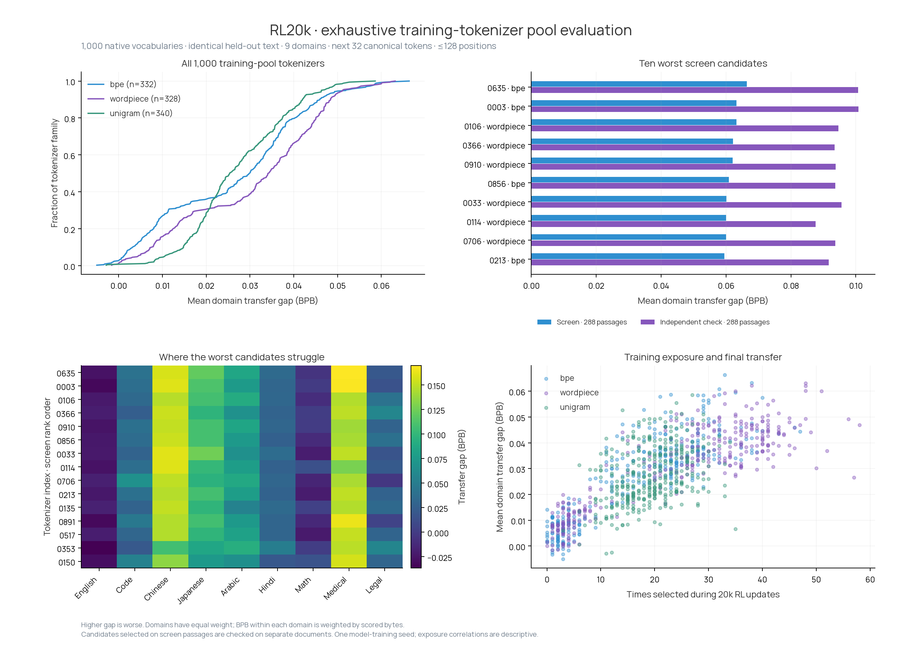

# RL20k: all 1,000 training-pool tokenizers

The largest screen loss belongs to **tokenizer 0635**: bpe, no-regex, requested vocabulary 120,000. It was selected 33 times during RL training.

Its mean domain BPB is **1.07968**, versus **1.01331** for the same trained LM with canonical inputs: a **+0.06637 BPB** transfer gap.

On separate confirmation passages, its gap is **+0.10073 BPB**. The largest confirmation loss among the selected candidates belongs to tokenizer **0003**. Treat this as a ranking on fixed held-out samples, not a proven unique worst tokenizer for all text.

The confirmation result does not distinguish tokenizer 0635 from 0003: the paired 95% interval for their BPB difference is [-0.00422, +0.00434].

## How the evaluation works

We use the final 20,000-step RL-trained language model and input hypernetwork. For each tokenizer, the hypernetwork reads its entire native vocabulary and produces input embeddings. The output head and continuation tokenization stay canonical.

Inference ran on four Modal B300 workers. All 1,000 original pool files are included, including the 11 pool members that were never selected during the RL run. Actual selection counts are included in the ranking.

Every tokenizer sees exactly the same 288 held-out passages: 32 each from English web, code, Chinese, Japanese, Arabic, Hindi, math, medical English and legal English. We score only the next 32 canonical tokens after each cut. The total context is at most 128 positions, including BOS. We shorten each raw prefix jointly until all 1,000 tokenizers fit and preserve the text exactly. Neither the scored continuation nor the document selection changes between tokenizers.

BPB means bits per UTF-8 byte; lower is better. First we compute BPB within each domain, then average the nine domain scores equally. This prevents a domain with longer byte strings from dominating the overall result. The canonical baseline is identical for every tokenizer, so ranking by BPB or by excess BPB gives the same order. The CSV also includes a pooled-byte score.

We selected the ten worst overall candidates and the worst candidate in every domain for a separate 288-passage confirmation set. The sets have disjoint source-document IDs. Confidence intervals resample paired passages within each domain. They describe uncertainty over these texts, not different model-training seeds, and are not corrected for multiple comparisons.

These shared contexts differ from the earlier OOD and training-sanity panels. Do not compare their absolute BPB values directly.

## Ten largest screen losses

| Rank | Tokenizer | Algorithm / pretokenizer | RL updates | BPB | Canonical | Gap | Confirmation gap |
|---:|---:|---|---:|---:|---:|---:|---:|
| 1 | 0635 | bpe / no-regex | 33 | 1.07968 | 1.01331 | +0.06637 | +0.10073 |
| 2 | 0003 | bpe / no-regex | 38 | 1.07651 | 1.01331 | +0.06320 | +0.10085 |
| 3 | 0106 | wordpiece / line256 | 48 | 1.07649 | 1.01331 | +0.06317 | +0.09466 |
| 4 | 0366 | wordpiece / line256 | 38 | 1.07549 | 1.01331 | +0.06218 | +0.09351 |
| 5 | 0910 | wordpiece / no-regex | 48 | 1.07532 | 1.01331 | +0.06200 | +0.09375 |
| 6 | 0856 | bpe / line256 | 32 | 1.07415 | 1.01331 | +0.06084 | +0.09363 |
| 7 | 0033 | wordpiece / line256 | 48 | 1.07342 | 1.01331 | +0.06010 | +0.09556 |
| 8 | 0114 | wordpiece / no-regex | 35 | 1.07338 | 1.01331 | +0.06007 | +0.08761 |
| 9 | 0706 | wordpiece / line256 | 51 | 1.07329 | 1.01331 | +0.05998 | +0.09364 |
| 10 | 0213 | bpe / line256 | 35 | 1.07282 | 1.01331 | +0.05951 | +0.09166 |

## Worst by domain

| Domain | Tokenizer | BPB | Canonical | Gap |
|---|---:|---:|---:|---:|
| English | 0337 | 0.92801 | 0.93568 | -0.00767 |
| Code | 0450 | 0.61768 | 0.53664 | +0.08104 |
| Chinese | 0687 | 2.06176 | 1.86356 | +0.19820 |
| Japanese | 0776 | 1.49439 | 1.34616 | +0.14823 |
| Arabic | 0170 | 1.34924 | 1.22311 | +0.12613 |
| Hindi | 0982 | 0.84010 | 0.76798 | +0.07212 |
| Math | 0281 | 0.68196 | 0.65283 | +0.02913 |
| Medical | 0635 | 0.90130 | 0.73149 | +0.16981 |
| Legal | 0569 | 1.13307 | 1.06236 | +0.07071 |

## Files and reproduction

* [ranking.csv](ranking.csv): all 1,000 screen ranks, settings, training exposures and domain scores.
* [screen.json](screen.json), [confirmation.json](confirmation.json): all evaluated per-passage losses and aggregates.
* [spec.json](spec.json): checkpoint/tokenizer hashes, settings, document IDs, counts and context hashes.
* [analysis.json](analysis.json): confirmation comparisons and uncertainty.
* [exposures.csv](exposures.csv): actual RL/uniform selection counts for every pool member.
* [manifest.json](manifest.json): file sizes and SHA-256 checksums for this report.
* [PDF plot](pool_sweep.pdf).

Run `python scripts/analyze_rl_pool.py --input reports/rl-pool-sweep-20k` from the source repository to verify the saved per-passage losses and regenerate this report. The inference entry point is `scripts/modal_eval_rl_pool.py`; the frozen design is `plans/rl-all-pool-20k.md`.

Raw text, tokenizer files and weights remain in the persistent Modal Volume `blackpantherx86 / anytok-rl-all-pool-20k`. The shared raw-text panel is `panel.json`; full features are `features/NNNN/`; individual scores are `screen/NNNN.json` and `confirm/NNNN.json`. No large artifacts were downloaded through the local caller.
