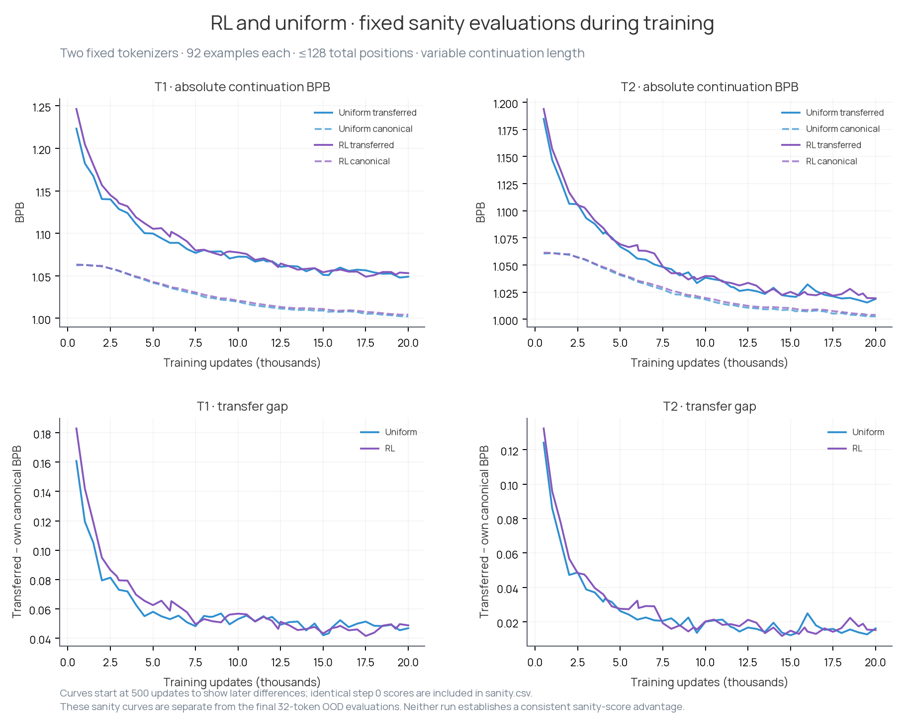
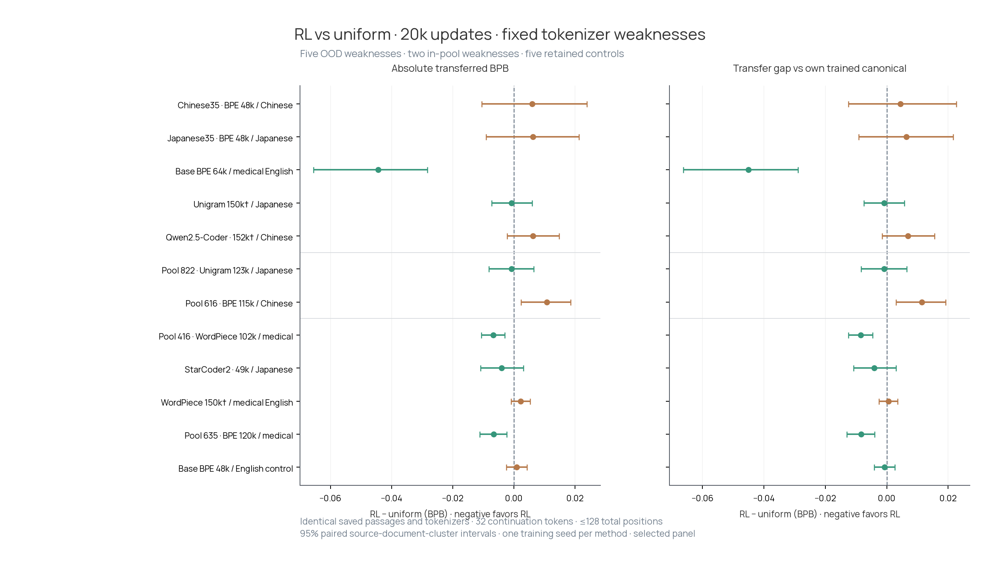
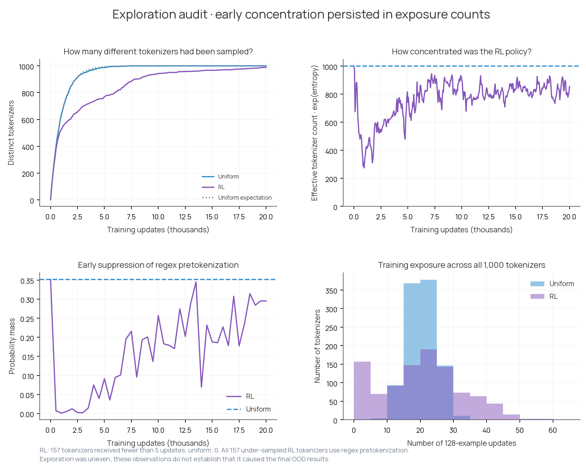

# RL tokenizer selection: what happened in the 20k-step run

**The policy learned preferences, but we did not establish a broad improvement
over uniform sampling.** Medical evaluations showed some gains. Most of the
difficult Chinese/Japanese cases remained difficult. Exploration was uneven,
especially early in training.

This folder collects the completed shared-settings RL experiment and its
comparison with uniform sampling. It contains the scores, configuration
metadata, relevant source code and plots. Both runs trained for 20,000 updates
using the same fixed pool of 1,000 tokenizers. No new tokenizers were generated
during the RL run.

## Read these first

1. [Setup](setup.md): what the model and policy do, what a training step means,
   and exactly which part of the text gets scored.
2. [Results](results.md): what happened during training and what the final
   evaluations showed, including the exploration audit.
3. [Reproduce and inspect the data](reproduction.md): regenerate figures on a
   CPU, verify the saved measurements, or find a particular table.

## During training

The model improved quickly at first. Its two fixed sanity evaluations stayed
close to the uniform baseline; RL did not develop a consistent lead. These
sanity evaluations are separate from the final OOD evaluations below.

## After training

On the original difficult cases, Base64k/medical improved, while Chinese35/Chinese
and Japanese35/Japanese showed no clear change. An in-pool Chinese case worsened.
The figure distinguishes absolute prediction loss from the extra loss caused by
using a transferred tokenizer. Negative differences favor RL.

## The important exploration finding

By step 5k, RL had tried 769 different tokenizers; uniform sampling would be
expected to try about 993. By 20k, 157 tokenizers had received fewer than five
training updates each, compared with zero in the actual uniform run. All 157 use
regex pretokenization. Sampling 989 tokenizers at least once therefore did not
mean that all received substantial training.

This is evidence of uneven exploration. It does **not** prove that exploration
caused the final evaluation differences. Broader generator coverage and reward
variation are other plausible contributors; [results.md](results.md) separates
the measurements from those explanations.

## Scope and limits

There is one training seed per method. The final panels were selected to examine
known weaknesses and useful compression, rather than to represent every possible
tokenizer. Confidence intervals describe variation across held-out source
documents, not across training runs. We have not run a forced-exploration or
continuous-generation comparison.

All seven figure sets are supplied as PNG and PDF in [plots/](plots/). Full
numerical measurements are in [data/](data/); [manifest.json](manifest.json)
records file sizes and SHA-256 hashes. Large checkpoints, tokenizer files and
raw corpora remain in persistent cloud storage; their locations are documented
in [reproduction.md](reproduction.md).
