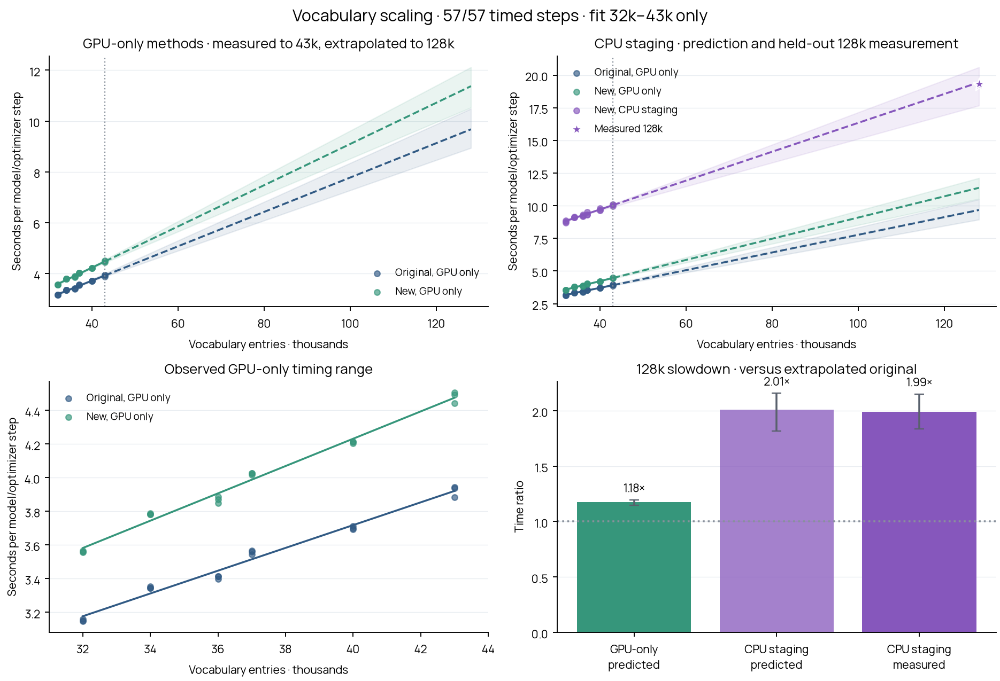

# Vocabulary size and training-step slowdown

This compares the original high-memory implementation, the new GPU-only implementation, and the complete lower-memory recipe with selected CPU staging. All measurements use the same local RTX PRO 6000, original step-2,000 checkpoint, original inputs and complete native tokenizer vocabularies. Production training is unchanged.

**Only native 32k–43k measurements enter the fit.** The original 128k step does not fit this GPU. Its timing is extrapolated, not measured. The staged 128k measurements are held out of fitting.

Status: 57 / 57 timed steps; complete. Each has a separate full-workload warmup followed by an exact checkpoint/RNG/corpus reload. Allocation stack tracing is disabled for all methods. CUDA peak counters remain enabled.



[PDF](vocab_scaling.pdf) · [Timing data](timings.csv) · [Fit data](analysis.json) · [Full trial records](results.json)

## Fit and 128k projection

The affine model is `seconds = intercept + slope × vocabulary_in_thousands`. At fixed source-piece length, hidden widths and 16 global latents, the hypernetwork’s dense work grows linearly with vocabulary. This motivates an affine fit; it does not guarantee that GPU kernels, memory traffic or CPU transfers will stay in the same regime at 128k.

| Method | Intercept (s) | Seconds / 1k entries | Predicted 128k (s) | Bootstrap 95% interval (s) | R² |
|---|---:|---:|---:|---:|---:|
| Original, GPU only | 1.010 | 0.0677 | 9.67 | 8.94–10.48 | 0.983 |
| New, GPU only | 0.985 | 0.0811 | 11.37 | 10.53–12.12 | 0.988 |
| New, CPU staging | 5.293 | 0.1106 | 19.44 | 17.67–20.60 | 0.970 |

## Slowdown at 128k

All ratios below divide by the **extrapolated original 128k time**. A ratio of 1 means equal speed; 2 means twice as many seconds per step.

| Comparison | Time ratio | Bootstrap 95% interval |
|---|---:|---:|
| GPU-only rewrite: both times projected | 1.18× | 1.15–1.20× |
| CPU staging: both times projected | 2.01× | 1.82–2.16× |
| CPU staging measured / original projected | 1.99× | 1.84–2.15× |

Measured staged 128k steps: 19.23s, 19.21s, 19.31s; mean 19.25s.
The staged holdout differs from its forecast by -0.99%. This checks the staged curve, not the unmeasured original 128k forecast.

## Scope and uncertainty

The pool begins at 32k. The observed range is only 11k entries wide, whereas 128k is 85k beyond its upper edge. The bootstrap intervals capture variation among the observed native vocabularies and repetitions under the affine assumption. **They are not a guarantee of 128k accuracy.** Leave-one-vocabulary-out prediction ranges are retained in analysis.json. No estimate is an H200/B300 throughput forecast.

Each timed step includes canonical scoring, complete hypernetwork and LM forward/backward, lexical loss, gradient clipping, the populated Adam update and any CPU transfers. Loading, example/tokenizer preparation, warmup, checkpoint reload and result logging are excluded. Kernels are warm; the allocator cache is cleared before checkpoint reload. This measures one controlled update after reload, not long-run steady-state throughput. New CPU staging is always enabled in its own curve, even at small vocabularies; it is not mixed with the GPU-only curve.

Six actual BPE/no-regex tokenizers are used: 32k (#494), 34k (#728), 36k (#14), 37k (#138), 40k (#550), 43k (#817). These native vocabularies are not truncated or padded. The 128k staged holdout is native tokenizer #989. Different vocabulary points have different tokenizer contents. The original paired-boundary construction can slightly change the scored suffix between vocabulary points; hypernetwork-only fits are also retained to separate that from the LM work. All methods and repetitions at a given point must match example proofs, scored bytes/tokens, both losses, lexical loss and final RNG exactly.

Every run retains the original batch 128, microbatch 32 and 128-position cap, full vocabulary-wide attention, canonical output head and lexical weight 0.5. The existing losslessness study and full 128k gradient checks are linked in [the prior report](../chunked-memory/README.md). This is a performance study, not a substitute for quality evaluation.

The target vocabulary affects the hypernetwork and transferred input embeddings; the LM output head remains canonical. The exact sampling order, source hashes, all phases, peaks and warmup/reload checks are saved in design.json and results.json. Three repeats per point use shuffled vocabulary order and rotated method order. No new paid cloud job was launched.

## Reproduce

```bash
.venv-memory/bin/python scripts/run_vocab_scaling.py --resume
.venv-memory/bin/python scripts/plot_vocab_scaling.py
```
